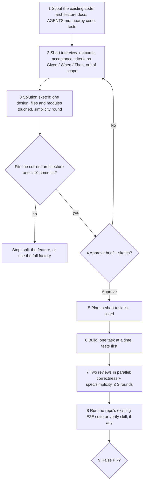

# Feature factory — a mini software factory for one feature

**Status:** built 2026-10-22 (§6). Run `/skill:feature <description>`
or `/skill:feature #<issue>` in an existing app repo; run it with no
arguments to resume.

## 1. Why a mini version

The full factory (`SOFTWARE-FACTORY.md`) is for building a whole application:
requirements, tech stack, and architecture each get their own gate, then the
app is split into issues, and each issue goes through about ten agents.

For one feature in an app that already exists, most of that is waste, and it
can do harm. The stack and architecture are already decided. A pipeline that
asks for two architecture candidates, a threat model, and a CONSTRAINTS file
pushes the agents toward designing new things, when the right answer for a
feature is usually "extend what is already there".

The feature factory does one thing: take one feature, fit it into the
existing architecture with the smallest change that fully does the job, and
deliver it as a reviewed PR.

## 2. The flow

| # | Step | Who | Model · effort | What comes out |
| --- | --- | --- | --- | --- |
| 1 | Scout the existing code | omp `scout` agent | `@scout` (Haiku 5.5 · medium) | Where the feature lands: modules, patterns, tests, conventions |
| 2 | Interview | you + main session | `@default` (Opus 5.5 · high) | Outcome, acceptance criteria (Given / When / Then), out of scope |
| 3 | Solution sketch | main session | `@default` (Opus 5.5 · high) | One design that names what it reuses and lists every new piece |
| 4 | Gate 1: brief + sketch | you | — | Approve / No |
| 5 | Plan | planner agent (skills: D6) | `@plan` (Opus 5.5 · high) | 1–10 tasks, each with its acceptance criteria |
| 6 | Build | builder agent (skills: D6) | Opus 5.5 · medium (`anthropic/claude-opus-5-5:medium` in its agent file) | Commits, each with its tests |
| 7 | Review | omp `reviewer` + spec/simplicity reviewer, in parallel | `@review` (GPT-6.1 Sol · high, falls back to Opus 5.5 · high) + `@default` (Opus 5.5 · high) | Verdicts; fixes go back to step 6, at most 3 rounds |
| 8 | QA | QA agent | Sonnet 5.5 · high (`anthropic/claude-sonnet-5-5:high` in its agent file) | Existing E2E suite / `verify-<app>` run, else a manual-check list |
| 9 | Gate 2: PR | you; main session writes the PR body | `@default` (Opus 5.5 · high) | Approve / No |

Models follow `SOFTWARE-FACTORY.md` §5.2 and §5.9: volume on Claude, GPT
only where a second model family pays off. Here that is one GPT run per
review round (the correctness review of Claude's code), against 2–3 per
issue in the full factory. The full factory's other GPT runs (architecture
candidate B, pre-mortem, builder check, holdout QA, design direction and
review) belong to stages this version drops. Each mapping:

- **Scout:** the full factory's pre-interview `scout` (§4.1), through
  `task.agentModelOverrides.scout` in `omp/config.yml`.
- **Interview, sketch, PR body:** the main session, as in §4.1 and §4.5
  (candidate A, the simplest design, is Opus in the main session).
- **Plan:** `factory-planner` (§5.2).
- **Build:** `factory-builder` (§5.2). Opus medium beats Sonnet high by 5–15
  points (§5.9); if Claude quota runs short it moves to Sonnet 5.5 · high,
  never medium. No unstick advisor or attempt-3 rerun: after 3 review
  rounds the run stops and flags you (D7).
- **Review:** the bundled `reviewer` through
  `task.agentModelOverrides.reviewer` (`@review`), plus `factory-spec-review`
  on `@default` (§5.2), so the two reviews come from different model
  families.
- **QA:** `factory-qa` (§5.2). Driving the app is computer use, where Sonnet
  and Opus are close (§5.9).

## 3. What is kept and what is dropped

| Full factory | Feature factory |
| --- | --- |
| Requirements, stack, architecture stages, each gated (§4.1–4.5) | One brief: acceptance criteria + solution sketch, one gate |
| Two architecture candidates + two-model adversarial review (§4.5) | One design; the simplicity round (§4.2) is the guard |
| Pre-mortem round, builder check (§4.2, §4.3) | Dropped |
| CONSTRAINTS.md, issue #0 bootstrap, threat model (§4.5, §4.7) | Dropped; uses the repo's existing lint, tests, and CI |
| GitHub issues and project board (§4.6) | Dropped; input is chat text or one existing issue `#N` |
| Planner, builder, unstick advisor agents (§5.2, §5.3) | One plan step and one build step, borrowing small skills (D6) |
| 7+ reviewers, holdout QA, mutation testing, pixel diff, security scan | Two reviewers; QA only through what the repo already has |
| `state.json`, ledger, hooks, budgets (§5.3, §5.6, §7) | Dropped; the task list and the branch's commits are the resume point |

## 4. How it avoids over-building

1. **Scout before any design.** The sketch must name the existing modules,
   files, and patterns it reuses. A sketch that names none is rejected
   before you see it.
2. **Every new piece is listed and questioned.** Each new dependency, file,
   table, abstraction, or config option gets a simplicity question with the
   simpler option as the recommended answer (ponytail ladder: does it need
   to exist; does the codebase, the standard library, the platform, or an
   installed dependency already do it?).
3. **A stop rule.** If the feature needs a new module, service, datastore,
   or runtime, changes module boundaries, or needs more than 10 commits, it
   is not a feature. The skill stops and says so.
4. **The spec reviewer has a "Simpler" axis** (`SOFTWARE-FACTORY.md` §5.2).
   Any wrapper, option, abstraction, or "for later" code that no acceptance
   criterion asks for comes back as Required.

## 5. Decisions

All twelve answered on 2026-10-22, each as the recommended option.

| # | Topic | Decision |
| --- | --- | --- |
| D1 | Name and shape | One skill, `feature` (~150 lines; first named `factory-feature`, renamed 2026-10-22), plus one agent file for the spec/simplicity reviewer |
| D2 | Primitives | Build `factory-grill` and `factory-gate` first; `feature` uses them, and the full factory reuses them later |
| D3 | Input | A description in chat or an existing GitHub issue `#N`. It never creates or edits issues |
| D4 | Gates | Two: Gate 1 approves the brief + sketch before code; Gate 2 approves raising the PR. Everything between runs unattended |
| D5 | Stop rule | Stop and tell you on a new module, service, datastore, runtime, module-boundary change, or more than 10 commits. A new library dependency is a question, with the simpler option recommended |
| D6 | Plan and build skills | Plan: addyosmani [`planning-and-task-breakdown`](https://raw.githubusercontent.com/addyosmani/agent-skills/main/skills/planning-and-task-breakdown/SKILL.md) task format (acceptance criteria + verification) and XS–XL sizing, where XL means stop. Build: mattpocock [`implement`](https://raw.githubusercontent.com/mattpocock/skills/main/skills/engineering/implement/SKILL.md) + [`tdd`](https://raw.githubusercontent.com/mattpocock/skills/main/skills/engineering/tdd/SKILL.md), plus addyosmani [`incremental-implementation`](https://raw.githubusercontent.com/addyosmani/agent-skills/main/skills/incremental-implementation/SKILL.md) rules 0 (Simplicity First) and 0.5 (Scope Discipline). Copy only the rules used and credit each source. Not used: `implementation-plan`, `review-implementation-plan`, `follow-implementation-plan`, `follow-plan-with-review` (they serve the manual chat flow), and pstack's [`feature` playbook](https://raw.githubusercontent.com/cursor/plugins/main/pstack/skills/poteto-mode/playbooks/feature.md) (its `architect` step is the over-design this version avoids) |
| D6b | Build mode | Unattended after Gate 1; you can ask for step-by-step review on a given run |
| D7 | Reviews | Two in parallel: omp's `reviewer` on `@review` (GPT, correctness) and the spec/simplicity/tests reviewer on `@default` (Opus). At most 3 fix rounds, then it flags you |
| D8 | QA | Run the repo's E2E suite or `verify-<app>` skill if one exists; otherwise a manual-check list in the PR. No holdout scenarios |
| D9 | UI features | Reuse the app's existing components; no Paper design unless you ask for one |
| D10 | Artifacts | No separate brief file. The approved brief goes into the task list and the PR's Why section |
| D11 | Branch and PR | Branch `feature/<slug>`; push only that branch; open the PR only after your Approve at Gate 2 |
| D12 | This document | Stays as the feature factory's design, cross-linked from `SOFTWARE-FACTORY.md` |

## 6. Built

| Piece | File |
| --- | --- |
| The skill (D1) | `skills/feature/SKILL.md` |
| Brief + sketch + task list + status | `skills/feature/brief-template.md`, filled at `.factory/feature/<slug>.md` in the app repo |
| Grilling and gate primitives (D2) | `skills/factory-grill/`, `skills/factory-gate/` |
| Spec/simplicity/tests reviewer (D1, D7) | `omp/agents/factory-spec-review.md` |
| Planner, builder, QA | `omp/agents/factory-planner.md`, `factory-builder.md`, `factory-qa.md` (shared with the full factory) |
| Run state, ledger, PR approval | `skills/factory/scripts/factory-state` (`init --mode feature`) |
| Push/PR/merge guard | `omp/hooks/pre/factory-guard.ts` |

Decisions made while building:

- **Where the brief lives (D10).** `.factory/feature/<slug>.md` in the app
  repo, kept out of git through `.git/info/exclude`. A new session resumes
  from it, the ledger, and the branch's commits.
- **Brief stamp.** Gate 1 stamps the brief's sha256 and records it in the
  ledger, then reopens the stamp so the task list and status can be written
  into the same file.
- **Planner is read-only.** It returns the task list; the main session writes
  it into the brief.
- **QA with nothing to run (D8).** `factory-qa` returns `BLOCKED` with a
  manual-check list; the feature factory treats that as non-blocking and puts
  the list in the PR body.
- **Unattended guard.** After Gate 1 (unless you asked for step-by-step) the
  run sets `unattended`, so the stage guard keeps the session from ending
  before the PR gate.
- **Moving to a new chat.** `/skill:feature pause` in the chat being left
  (after Escape) writes `.factory/handoff.md`: decisions made in chat but not
  yet in the brief, open review findings, questions waiting on you, work in
  progress, and the next action. `/skill:feature` in a new chat reads it,
  checks it against the branch and ledger, and sends a decision that changes
  the approved brief back through Gate 1.
