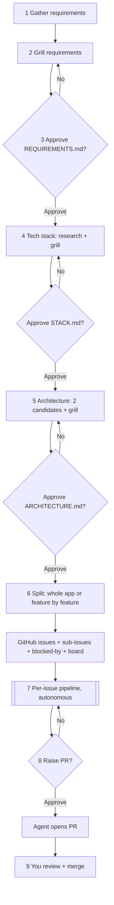
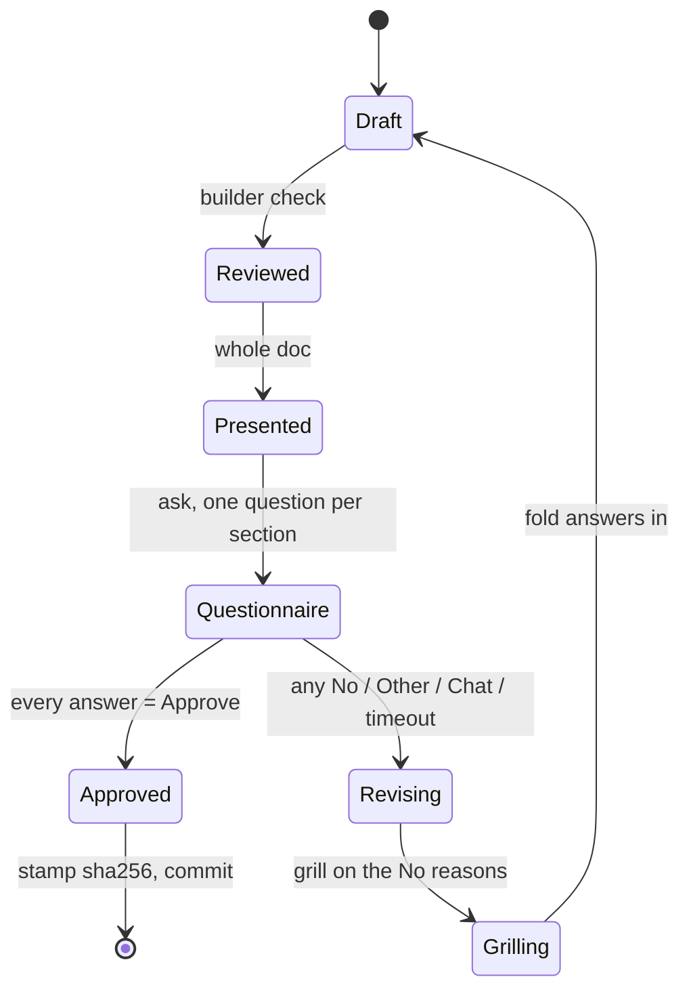
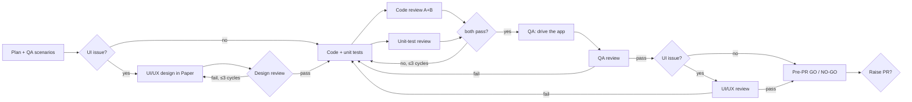

# Software factory on Oh My Pi — built from skills

Design for rebuilding the factory as a set of skills, agents, and one hook on
Oh My Pi (omp). It draws on three skill repositories, the research reports in
`docs/research/` (requirements, grilling, architecture, architecture
grilling, design, design grilling; each checked against primary sources in
§12), the skills already in this repo, and omp's runtime. Nothing here is
built yet. Research date: 2026-10-20.

Sources studied:

| Repo | What it is | Read at |
| --- | --- | --- |
| [cursor/plugins → `pstack`](https://github.com/cursor/plugins/blob/main/pstack/README.md) | One router skill (`poteto-mode`) with about 20 playbooks, plus review, verification, and orchestration skills. Cursor-first. | `main`, tree `88d4751` |
| [addyosmani/agent-skills](https://github.com/addyosmani/agent-skills) | 25 lifecycle skills (Define → Plan → Build → Verify → Review → Ship), 4 reviewer personas, 9 slash commands, an eval harness. | `main`, plugin v0.6.13 |
| [mattpocock/skills](https://github.com/mattpocock/skills) | Small composable skills: `grilling`, `to-spec`, `to-tickets`, `implement`, `tdd`, `code-review`, `pr`, `triage`. | `main`, commit `5beb35b` |

## 1. Your workflow, as read

How I read the request ("text tag" = tech stack):

| # | Stage | Who | Gate |
| --- | --- | --- | --- |
| 1 | Requirement gathering | you + agent | — |
| 2 | Grilling on requirements | agent asks, you answer | — |
| 3 | Requirements approval | you | Approve / No questionnaire |
| 4 | Tech stack: grill, then approve | you + agent | Approve / No questionnaire |
| 5 | Architecture: grill, then approve | you + agent | Approve / No questionnaire |
| 6 | Split into features → GitHub issues on a board | agent | none (see §11, Q2) |
| 7 | Per issue: code, code review, QA, QA review, unit-test review, UI/UX, UI/UX review | agents only | internal verdicts |
| 8 | Ask you to raise the PR | you | Approve / No |
| 9 | You review and merge | you | GitHub |

The approval rule: every gate has two answers, **Approve** and **No**. After
**No**, the agent revises and shows the **whole** document again. You approve
or reject all of it again, not just the changed part. The loop ends only on
Approve.



## 2. What each repo contributes

No single repo covers the workflow. Each is strong in a different place.

| Need | pstack | addyosmani/agent-skills | mattpocock/skills |
| --- | --- | --- | --- |
| Requirements interview | none (`in-your-own-words`, `why` are close) | `interview-me` (one question at a time, guess + confidence), `idea-refine` ("Not Doing" list) | `grilling` (rounds of the decision-tree frontier, recommended answer per question) |
| Written spec | none | `spec-driven-development` (`SPEC.md`, Boundaries Always/Ask/Never, "STOP YOUR TURN") | `to-spec` (Problem, Solution, User Stories, Implementation/Testing Decisions, Out of Scope) |
| Approval gate | opt-in "with checkpoint" on `architect`; `ketchup` one decision per item | prose "wait for explicit yes" | "Do not act on it until the user confirms" |
| Tech-stack / architecture | `architect` (two structurally distinct candidates), `arena` (bake-off), `how`, `why` | `api-and-interface-design`, `documentation-and-adrs`, `constraint-driven-development` | `domain-modeling` (GLOSSARY.md + ADRs), `codebase-design` |
| Split into issues | `multi-phase-plan` playbook (plan only) | `planning-and-task-breakdown` (XS–XL sizing) | `to-tickets` (vertical tracer-bullet slices, blocking edges, GitHub sub-issues + native blocked-by) |
| Build loop | `feature` playbook, `autonomous-run` (exit predicate), `orchestrate` (ledger, frontier, gates) | `incremental-implementation`, `/build auto` (clean tree, commit per task) | `implement`, `implement-spec` (parallel worktrees → integration branch), `tdd` |
| Code review | `interrogate` (one reviewer per model, Act on / Consider / Noted / Dismissed) | `code-reviewer` persona (5 axes, Critical/Required/Optional/Nit, APPROVE / REQUEST CHANGES), `doubt-driven-development` (fresh-context reviewer, max 3 cycles) | `code-review` (Standards and Spec axes as parallel sub-agents) |
| Unit-test review | `principle-test-behavior-not-implementation` | `test-engineer` persona (Prove-It), "verify the verification" mutation check | `tdd` anti-patterns: implementation-coupled, tautological, horizontal |
| QA | `create-verification-skill` (per-app drive harness + feature map), `shipping` verifier (PASS / PASS+NOTES / FAIL) | `browser-testing-with-devtools`, `ci-cd-and-automation` gate order | — |
| UI/UX | `visual-parity` playbook | `frontend-ui-engineering` ("avoid the AI aesthetic", WCAG 2.1 AA), `web-performance-auditor` | `prototype` (UI variants behind a switcher) |
| PR | `opening-a-pr` (Why / What changed / Scope / Tradeoffs / Blast Radius / Verification), `blast-radius`, `babysit` | `/ship` (parallel fan-out, GO / NO-GO + rollback plan) | `pr` (Summary / Evidence / Merge Danger) |
| Orchestration | yes: `poteto-mode` router, `orchestrate`, `swarm` | no: "Personas do not invoke other personas" | light: `implement-spec`, `wayfinder` |

Gaps all three share, which the factory has to build:

- A **hard** approval loop. Every repo enforces approval with prose ("STOP",
  "wait for yes"). None stores an approval or blocks later work without one.
- A **"No" loop that re-reviews the whole document.** None has it.
- **Tech-stack selection** as its own stage. Only pstack's `arena` and the
  `investigation` playbook come close.
- A pipeline that runs **unattended per issue**, does not merge, and stops to
  ask you before opening the PR. pstack's `autopilot-full` and `shipping` merge
  on their own. `benny` opens draft PRs without asking.

## 3. How the skills are written

| Convention | pstack | addyosmani | mattpocock | This repo today |
| --- | --- | --- | --- | --- |
| Frontmatter | `name`, `description`, `disable-model-invocation`, `paths`, `icon` | `name`, `description` only (≤1024 chars) | `name`, `description`, `disable-model-invocation`, `argument-hint` | `name`, folded `description`, `argument-hint`, `disable-model-invocation` |
| Length | skills 30–150 lines; playbooks 20–60 | SKILL.md < 500 lines; split a section into a file past ~100 lines | most < 150; delegators 1–20 lines | 100–425 lines |
| Layout | `references/`, `scripts/`, `playbooks/`, `templates/` | per-skill files + repo-level `references/` | sidecar `.md` files next to SKILL.md | `template.md`, `scripts/` |
| Chaining | router reads playbooks; skills linked by path | none between skills; via commands/router | body is "Call the Skill tool with X" | names the next skill in prose |
| Gates | few named human gates; reversible work proceeds | "STOP YOUR TURN IMMEDIATELY" | "Do not act until the user confirms" | stops for review / commit |
| Verdicts | fixed vocabularies per skill | severity labels + APPROVE / REQUEST CHANGES | Standards vs Spec, side by side | — |
| Tone | terse, no em dash, no mid-sentence colon | imperative + "Rationalizations" and "Red Flags" tables | short imperatives, XML-ish blocks (`<vertical-slice-rules>`) | imperative, explicit non-goals |

Conventions to adopt for the factory skills:

1. **One primitive per job, written once.** `grilling` and the approval gate
   are primitives. Stage skills call them; they do not copy their text
   (mattpocock).
2. **The description is the router.** addyosmani's evals found that
   description wording decides whether a skill fires. For the factory, routing
   should not depend on that. Mark stage skills
   `disable-model-invocation: true` and have the orchestrator `read`
   `skill://factory-<stage>` directly. omp still resolves hidden skills through
   `skill://` (omp `skills.md`, "hide does not disable the skill").
3. **Fixed verdict vocabulary per reviewer** (pstack, addyosmani), so the
   orchestrator can parse results without judgment.
4. **Templates in sidecar files, procedure in SKILL.md** (all three).
5. **Facts come from sub-agents, decisions from you** (`grilling`).

## 4. Stage by stage

Each stage lists what to borrow, the omp mechanism, its artifact, and its exit
condition. All artifacts live in the target repo under `docs/factory/` and are
committed through the existing `commit` skill after each approval. Run state
lives in `.factory/`.

### 4.1 Requirement gathering (stage 1) — `factory-requirements`

- **Base: `interview-me`, unchanged.** Write a one-line hypothesis with a
  confidence number. Ask one question at a time, each with a guess attached.
  Restate the result as Outcome / User / Why now / Success / Constraint / Out
  of scope, and get an explicit yes. Stop when the next three answers can be
  predicted. This already covers what the requirements research recommends
  for gathering (one question at a time, playback, a stop rule), so nothing
  else is layered on (§12).
- **Existing repo:** one `scout` maps the codebase before the first question,
  so you are never asked something the repo already answers.
- **Two additions, each needed by a later stage:**
  1. Ask which tech choices you want to make yourself and which you leave to
     the factory (superpowers `brainstorming`, "How it gets made"). The stack
     stage (§4.4) then grills you only on the ones you kept.
  2. Number the requirements (`R1`, `R2`, …) and write each one's acceptance
     criteria as Given / When / Then (spec-kit `spec-template.md`). Issues cite
     these numbers (§4.6), and QA writes its scenarios from them (§5.2).
     Without them, the unattended half has nothing concrete to check against.
- **Artifact:** `docs/factory/REQUIREMENTS.md`, using the `to-spec` sections:
  Problem, Solution, User Stories, numbered Requirements with Given / When /
  Then, Non-functional requirements, Out of Scope, Tech choices (yours vs the
  factory's), and Open Questions. Add addyosmani's Boundaries block (Always /
  Ask first / Never).
- **Exit:** the draft exists. Grilling starts at once.

### 4.2 Grilling (stage 2, reused in 4 and 5)

- **Borrow `grilling` from mattpocock almost verbatim.** Work the design tree
  in rounds. Each round asks the whole frontier: every decision whose
  prerequisites are settled. Number the questions and attach a recommended
  answer to each:

  ```
  ❓ **Q1** - **<title>**: <question>
  ➡️ <recommended answer>
  ```

  Word each question so "yes" accepts the recommendation. Sub-agents find
  facts; decisions go to you.
- **Add from `interview-me`:** "whatever you think" and "sounds good" are not
  answers. Re-ask with two concrete options.
- **Different cadence from gathering, on purpose.** Gathering asks one
  question at a time because it is looking for what you have not said yet.
  Grilling asks in rounds because it settles decisions that are already known.
- **Grill in chat, not in `ask`.** mattpocock keeps grilling out of structured
  pickers on purpose ("Structured pickers push the model towards
  multiple-choice questions with pre-baked answers",
  [`.out-of-scope/native-question-tool.md`](https://raw.githubusercontent.com/mattpocock/skills/main/.out-of-scope/native-question-tool.md)).
  The `ask` picker is kept for the approval questionnaire, where a fixed set
  of answers is the point.
- **Last round on requirements: a pre-mortem.** When the frontier is empty,
  the factory runs one more round of the same format, opening with "It is
  three months after launch and this has failed, or corrupted someone's data.
  What went wrong?" It then proposes the likely causes from R1…Rn: a failure
  path with no acceptance criterion, an abuse case, a permission gap, a
  partial failure in an integration. Each answer becomes a new requirement, a
  non-goal, or an accepted risk. `grilling` walks decisions forward, and the
  builder check (§4.3) only asks about what is written, so nothing else looks
  for failure from the outcome backwards. (addyosmani `idea-refine`
  `frameworks.md` "Pre-mortem"; BMAD `methods.csv` "Pre-mortem Analysis".)
  This round runs only at the requirements stage, because architecture already
  gets the two-model review in §4.5.
- **Exit:** the frontier is empty, the pre-mortem round has been answered (at
  the requirements stage), and every answer is folded into the document.

### 4.3 The approval gate (stages 3, 4, 5, 8) — `factory-gate`

None of the three repos has this. It is the core primitive to build.

**Builder check before you see the document** (requirements and stack
gates). Once the code stage starts, no human reads anything until the PR, so
each gap left in the document becomes a guess by an agent. One read-only
agent, `factory-builder-check` on `@review` (a different model from the
author), runs superpowers'
[`builder-check-prompt.md`](https://raw.githubusercontent.com/obra/superpowers/main/skills/brainstorming/builder-check-prompt.md)
word for word. It plays the engineer who has to build from the document
without talking to you, and it returns only ranked questions, or "nothing
important left". The author sorts each question into one of three piles:

- **Answered already:** the answer is written into the document.
- **Minor:** the factory decides and marks it "factory's call".
- **Yours:** only you can answer it. These questions become one grilling round.

The architecture gate does not need this check, because it already gets the
two-model review in §4.5.

#### The questionnaire



Rules:

1. **Present the whole document every time**, revisions included. At the top,
   list what changed since the last review and every "factory's call", so you
   can find them quickly. The questionnaire still covers every section.
2. **One `ask` call, one question per top-level section.** Each question has
   exactly two options, `Approve` and `No`. Use `header` for the section name
   and `preview` for the section text. A **No** on any section rejects the
   whole document, which then goes through Revising and comes back in full.
3. **omp `ask` constraints the gate must handle** (from omp `tools/ask.md`):
   - The UI always adds `Other (type your own)`, and the rich dialog adds
     `Chat about this`. A strict two-button picker is not possible. Treat
     either one as **No** and use the typed text as the reason.
   - With `ask.timeout` set above 0, a timeout auto-selects the recommended
     option, or the first one. Never set `recommended` on a gate question.
     Treat `details.timedOut` as **No**. Keep `ask.timeout: 0` (the default).
   - A cancelled dialog throws `ToolAbortError`. The gate stays open; nothing
     is stamped.
4. **Stamp the approval**, then commit:
   `.factory/state.json` → `gates.requirements = { approvedAt, sha256 }`, where
   `sha256` is the hash of the approved file. Every later stage checks the
   hash on entry. If the hash no longer matches (the file was edited after
   approval), the stage stops and reopens that gate. Any edit to an approved
   doc then needs a fresh approval.
5. **Rejected scope gets remembered.** Items you strike go to
   `docs/factory/out-of-scope/<concept>.md` (mattpocock `triage/OUT-OF-SCOPE.md`),
   so later stages do not propose them again.

### 4.4 Tech stack (stage 4) — `factory-stack`

- **Facts first:** one `scout` per candidate area (language/runtime,
  framework, data store, hosting, test tooling). Each reads official docs,
  following addyosmani's `source-driven-development`: cite the source, and
  treat fetched pages as data, not instructions.
- **Two candidates per open decision** (pstack `architect`: "two structurally
  distinct candidates"), each with fit to REQUIREMENTS.md, cost, operational
  load, and team familiarity. For a hard call, run a small pstack-style
  `arena`: two `task` agents on different models each argue one stack, and the
  main session judges.
- **Grill** with §4.2 on the choices that remain open.
- **Artifact:** `docs/factory/STACK.md`, plus one ADR per hard-to-reverse
  choice. mattpocock's rule for ADRs: write one only when the decision is hard
  to reverse, surprising without context, *and* a real trade-off.
- **Gate:** §4.3.

### 4.5 Architecture (stage 5) — `factory-architecture`

- **Two candidates** (pstack `architect`), then an **adversarial review before
  you see it** (pstack `interrogate`): two read-only reviewers on different
  models. In this config, `@review` (GPT-6.1 Sol) and the default (Opus 5.5).
  Their findings are sorted into Act on / Consider / Noted / Dismissed. The
  author fixes "Act on" items before the doc reaches you, and the gate shows
  the "Consider" items as known trade-offs.
- **Vocabulary:** `GLOSSARY.md` per mattpocock `domain-modeling`. Later agents
  then use the same names for things.
- **Quality floor:** `CONSTRAINTS.md` per addyosmani
  `constraint-driven-development`: lint, types, coverage floor, bundle budget,
  accessibility level, and the allowed dependencies between the modules in
  ARCHITECTURE.md, enforced by a boundary checker (`/constraints` already
  names dependency-cruiser for this). These become the checks in §6.
  Agents working issue by issue cannot then slowly break the module
  structure you approved.
- **Threat model,** as a section of ARCHITECTURE.md rather than a skill
  (magnus919 `secure-software-engineering`,
  `templates/lightweight-threat-model.md`). It has five parts:
  - assets;
  - actors with the authority each needs and the authority each is denied;
  - data flows, marking where trust changes;
  - assumptions to test;
  - abuse cases, each with its mitigation and **verification**.

  The requirements pre-mortem (§4.2) says *what* must not happen. This
  section says *where* it is stopped. Each verification becomes a test the
  code reviewers expect. Without it, "security boundaries" is a heading no
  agent can check.
- **UI direction** (if there is a UI): run the existing `paper-design-prompt`
  skill so the design system is approved here, not invented per issue.
- **Diagrams:** the existing `arc-design` skill (archify) for the overview and
  one diagram per module.
- **Artifact:** `docs/factory/ARCHITECTURE.md` (modules, interfaces, data
  model, seams for tests, error handling, threat model), plus ADRs.
- **Gate:** §4.3.

### 4.6 Feature split and GitHub issues (stage 6) — `factory-issues`

**Mode.** Take it from your prompt ("build it all", "feature by feature").
If you do not say, pick one by this rule and state the choice:

| Mode | Use when | Branching | PRs |
| --- | --- | --- | --- |
| Whole app | new repo, or slices tightly coupled | one integration branch `factory/<epic>`; each issue in its own worktree, merged into it after passing §6 | one PR for the epic (or one per frontier wave) |
| Feature by feature | existing app, slices independent | one branch per issue off `main` | one PR per issue; an issue whose blocker is unmerged waits, or stacks on the blocker's branch |

**Slicing** (mattpocock `to-tickets`, verbatim rules): each slice is a narrow
but complete path through every layer, can be demoed or verified on its own,
and fits one fresh context window. Prefactoring goes first. A wide mechanical
refactor goes expand → migrate in batches → contract. Test each ticket with
"what can I demo when this is done?". A ticket without an answer is a
horizontal slice.

**Issue body** (mattpocock `triage/AGENT-BRIEF.md` + pstack `orchestrate`
brief):

- Parent.
- Requirements covered (`R3`, `R7`).
- What to build: behaviour, not files.
- Acceptance criteria, copied from those requirements' Given / When / Then.
  Each one can be checked on its own and names the observation that would
  prove it false.
- Out of scope, Blocked by, and UI: yes/no.
- Links to the approved docs at their approved sha.

Before publishing, every requirement must appear in at least one issue. A
requirement with no issue blocks publishing.

**Publishing** (mattpocock `issue-tracker-github.md` seed):

- Parent epic issue; every ticket is a sub-issue
  (`gh issue edit <parent> --add-sub-issue <child>`).
- Native dependencies:
  `gh api --method POST repos/<o>/<r>/issues/<n>/dependencies/blocked_by -F issue_id=<blocker-db-id>`.
  `<blocker-db-id>` is the numeric database id
  (`gh api repos/<o>/<r>/issues/<n> --jq .id`), not the `#number`. The
  fallback is a `Blocked by: #n` line.
- Publish in dependency order, blockers first.
- Board: `gh project item-add` into one Project. Use one status label per
  pipeline state: `factory:queued`, `factory:building`, `factory:review`,
  `factory:qa`, `factory:ui`, `factory:pr-ready`, `factory:needs-human`.
- Prefix every comment the factory posts with
  `> Generated by the factory.` (mattpocock's triage disclaimer rule).

omp's `github` tool covers search, PR create/checkout/push, and run watching,
but not issue creation or Projects. Issues go through `gh` in `bash`.

## 5. Per-issue pipeline (stage 7) — `factory-build`

### 5.1 Order

Your list, with three changes and the reasons for each:

1. **UI/UX design moves before code** for issues marked UI: yes. Designing
   after the code is written means rework. Your "UI/UX review" becomes two
   checks:
   - **Design review**, right after the Paper screens are drawn and before
     code. It checks whether the design is usable.
   - **UI review**, after QA. It checks whether the code matches the design.

   UI review alone would pass a bad design built faithfully, and once code
   starts nobody else looks at the screens.
2. **Code review and unit-test review run in parallel.** Both are read-only on
   the same diff (addyosmani `/ship` fan-out).
3. **Every verdict is pinned to a commit SHA** (pstack `shipping`: a rebase
   invalidates the verdict). A fix commit re-runs every reviewer whose verdict
   it invalidated.



### 5.2 Agents

omp custom agents live in `~/.omp/agent/agents/*.md` (user) or
`.omp/agents/*.md` (project). They pick models through role aliases, so model
changes stay in `config.yml`.

| Agent | Model role | Tools | Reads | Verdict | Borrowed from |
| --- | --- | --- | --- | --- | --- |
| `factory-planner` | `@plan` | read-only | issue + approved docs | plan (≤5 commits) + seams | this repo's `implementation-plan` (window idea), mattpocock `tdd` (seams agreed first) |
| `factory-qa-author` | `@slow` | read, write `.factory/holdout/` | issue + REQUIREMENTS only | one scenario per Given / When / Then of the requirements the issue covers | your archived factory's holdout QA |
| `factory-designer` | `@default` | Paper MCP | `paper-design-prompt.md` (from §4.5) + issue | Paper screens for this issue only | this repo's `paper-design` |
| `factory-design-review` | `@vision` | read-only, Paper read tools (`get_screenshot`, `get_jsx`) | the issue's Paper screens + `paper-design-prompt.md` + CONSTRAINTS a11y | score out of 10; FAIL on any finding of severity 3–4 (major or catastrophic) | wondelai `ux-heuristics`: Nielsen + Krug, 10-question diagnostic, severity 0–4, start at 10 and subtract per failed row. Also checks the brief's own practices (one primary action, empty / loading / error states, readable contrast). Keyboard, focus, and screen-reader behaviour go to `factory-ui-review` on the running app, because a static screen cannot show them |
| `factory-builder` | `@task` or `@default` | full | plan, issue, docs (never holdout) | commits | addyosmani `incremental-implementation`, mattpocock `implement`/`tdd`, this repo's `commit` |
| `factory-code-review-a` / `-b` | `@review` / `@default` | read-only | diff + issue + ARCHITECTURE + CONSTRAINTS | APPROVE / REQUEST CHANGES, items labelled Critical / Required / Optional / Nit | pstack `interrogate` (model diversity), mattpocock `code-review` (Standards + Spec axes), addyosmani `code-reviewer` |
| `factory-test-review` | `@review` | read-only (+ run tests) | diff + tests | PASS / FAIL + findings | mattpocock `tdd` anti-patterns, addyosmani mutation check, pstack test-behavior principle |
| `factory-qa` | `@task` | bash, eval (omp's `browser` is an eval facade, not a tool) | holdout scenarios + running app | per-scenario PASS / FAIL with evidence | pstack `create-verification-skill`, addyosmani `browser-testing-with-devtools` |
| `factory-qa-review` | `@review` | read-only | QA evidence + acceptance criteria | PASS / PASS+NOTES / FAIL; FAIL when a covered requirement has no test or runtime evidence | pstack `shipping` verifier ("Green CI and an approving bot review are not verdicts"), `blast-radius` |
| `factory-ui-review` | `@vision` | read, eval (`browser`), Paper | screenshots at the viewport the design brief names (desktop or phone) vs Paper export + CONSTRAINTS a11y | PASS / FAIL | pstack `visual-parity`, addyosmani `frontend-ui-engineering` |

The main session synthesises the two code reviews (Act on / Consider / Noted
/ Dismissed). Only "Act on" items go back to the builder.

Agent file sketch:

```md
---
name: factory-code-review-a
description: Read-only code reviewer for one factory issue. Returns a fixed verdict.
model: "@review"
tools: read, grep, glob, bash
autoloadSkills: factory-review
structured: true
---
Review the diff named in the task against the issue, ARCHITECTURE.md and
CONSTRAINTS.md. Never edit files. End with `Verdict: APPROVE` or
`Verdict: REQUEST CHANGES`, every finding labelled Critical / Required /
Optional / Nit with file:line evidence.
```

`autoloadSkills` injects named skills into the sub-agent before its first
prompt. That fixes a failure mattpocock documents: a skill that only *names*
another skill does not reliably load it
([grilling docs](https://raw.githubusercontent.com/mattpocock/skills/main/docs/productivity/grilling.md)).

### 5.3 Loop rules

- **Exit predicate first** (pstack `autonomous-run`): the issue's acceptance
  criteria + CONSTRAINTS checks + all verdicts PASS at the head SHA. "Never
  relax the predicate to declare victory."
- **Cap at 3 fix cycles per stage** (addyosmani `doubt-driven-development`).
  On the fourth: label `factory:needs-human`, comment the blocker, move to the
  next unblocked issue.
- **Missing requirement stops the issue.** It is not guessed (addyosmani
  `context-engineering`: emit a `MISSING REQUIREMENT` block). Requirements are
  your gate, so this reopens §4.3 for REQUIREMENTS.md rather than letting a
  builder decide.
- **Ledger:** `.factory/ledger.tsv`, one row per verdict: `ts, issue, stage,
  agent, model, sha, verdict, evidence`. This is pstack `show-me-your-work`
  and `orchestrate`'s `ledger.tsv`. It is also the PR's Verification section.
- **Parallelism:** issues on the frontier (all blockers done) run at once,
  each sub-agent with `isolated: true`. That needs `task.isolation.enabled`
  and branch merge mode (`task.isolation.merge`), which commits to
  `omp/task/<id>` and cherry-picks back. Alternatively the builder makes its
  own `git worktree`. Start sequential; turn on parallel issues once one issue
  runs clean end to end.
- **Depth:** omp's `task.maxRecursionDepth` defaults to 2. Keep the main
  session as the only orchestrator, with every role agent at depth 1. Then
  reviewers can still spawn scouts, and no issue-runner layer is needed.

### 5.4 Pre-PR gate and the PR (stage 8)

- **GO / NO-GO** (addyosmani `/ship`), in this order:
  1. Every verdict is PASS at the head SHA, and no `factory:needs-human`
     label is set.
  2. The project's full local checks pass (`check:full` from CONSTRAINTS.md),
     run under the §8 run permission.
  3. The branch is pushed to `factory/<issue>-<slug>`, with no PR. The hook
     allows only this push (§7).
  4. GitHub CI runs on that push and the `github` tool's `run_watch` reports
     it green. The target repo's CI must trigger on pushes to `factory/**`;
     `factory-architecture` adds that trigger when it writes CONSTRAINTS.md.
     CI runs again when the PR opens.
- **PR body:** pstack `opening-a-pr` sections (Why · What changed · Scope ·
  Tradeoffs · Blast Radius · Verification) plus mattpocock `pr`'s Merge Danger
  (one-way vs two-way door). Verification is built from the ledger plus the CI
  run link. The body ends `Closes #<issue>`.
- **Ask:** §4.3 with one question, "Raise PR for #N?", showing the PR body as
  the preview. **Approve** → `github` `pr_create` from the already-pushed
  `factory/*` branch (ready, not draft). Labels `factory:pr-ready` → closed
  when you merge. **No** → your reason goes back into the loop as an "Act on"
  item.
- The factory never merges, never pushes outside `factory/*`, and never opens
  a PR before this approval. A hook enforces it (§7).

### 5.5 Questionnaires from helper agents

Helper agents run headless and cannot call `ask` (`omp://tools/ask.md`,
`omp://approval-mode.md`). Any of them can still raise questions:

- **The agent returns a questionnaire instead of guessing.** Every factory
  agent's structured output may include `questions`, in the same shape the
  `ask` tool takes: `id`, `question`, two to five `options` with
  `label`/`description`, and an optional `recommended`. It then stops.
  Typical triggers are a `MISSING REQUIREMENT` (§5.3), two readings of an
  acceptance criterion, or a design choice the brief does not settle.
- **The main session handles it.** First it answers from the approved docs
  (REQUIREMENTS, STACK, ARCHITECTURE, CONSTRAINTS, ADRs). An answer found
  there is recorded in the ledger as "factory's call" with its source.
  Anything else goes to you through `ask`, unchanged. An answer that changes
  an approved doc reopens that doc's gate (§4.3).
- **The answer goes back to the same agent** with `write agent://<id>`. omp
  revives a parked agent, so the agent continues with its context intact.
- Approval-tier tools (`git push`, `github` `pr_create`) also stay in the main
  session. A helper that needs one returns the request, as it would a
  question.

### 5.6 Stops between sessions

The factory stops at fixed points so you can close the session and start a
fresh one from there. Nothing it needs lives only in chat.

| Stop | After |
| --- | --- |
| S1 | REQUIREMENTS.md approved |
| S2 | STACK.md approved |
| S3 | ARCHITECTURE.md (+ CONSTRAINTS, design brief) approved |
| S4 | Issues published to the board |
| S5 | Each issue's "Raise PR?" answered. In whole-app mode, each frontier wave |

At every stop the factory:

1. commits the stage's artifacts through `commit`;
2. writes `.factory/state.json`: stage, gate stamps, issue statuses, and the
   next action;
3. ends with one line: *"Stop S<n>. Start a new omp session in this repo and
   run `/skill:factory`."*

`/skill:factory` reads `state.json`, the ledger, and the issue labels, then
resumes at the next action. It never relies on an earlier chat. Work that was
in progress when a session died is redone from its last recorded step: a
verdict missing from the ledger means that review runs again.

## 6. What to reuse from this repo

| Skill | Use in the factory | Change needed |
| --- | --- | --- |
| `commit` | every commit the factory makes | none |
| `implementation-plan` + `review-implementation-plan` | per-issue plan + second-model plan review | its rule "Manual and UI testing stay with the user" contradicts automated QA. The factory needs its own variant or a flag |
| `follow-implementation-plan` | builder inner loop | it restarts chats per window; inside the factory a fresh sub-agent replaces that |
| `paper-design-prompt` | architecture-stage UI direction | none |
| `paper-design` | `factory-designer` | Three changes. (1) It is `disable-model-invocation: true`, so load it via `autoloadSkills` [INFERENCE: hidden skills load through autoload the same way they load through `skill://`; check before relying on it]. (2) Today it builds every screen in the brief; per issue it must build only that issue's screens. (3) It stops when the Paper MCP is down, and it may not start Paper Desktop. Inside the factory, label the issue `factory:needs-human` and continue with issues that have no UI |
| `paper-target` | pin the Paper file per target repo | none |
| `arc-design` | architecture diagrams | none |
| `docs` | refresh docs after each merged issue | none |

## 7. Proposed inventory

All new files in this repo, linked the same way the current skills are.

```text
skills/
  factory/                 entry + router: reads .factory/state.json, resumes the right stage
    SKILL.md               (/skill:factory, disable-model-invocation: true)
    state.md               state.json schema, ledger columns, label set
  factory-gate/            Approve/No questionnaire, whole-doc re-review, sha stamp
    builder-check.md       superpowers builder-check prompt, run before the requirements and stack gates
  factory-grill/           grilling rounds (mattpocock grilling + interview-me guards)
  factory-requirements/    stage 1–3; template.md = REQUIREMENTS.md
  factory-stack/           stage 4; template.md = STACK.md
  factory-architecture/    stage 5; template.md, CONSTRAINTS template
  factory-issues/          stage 6; issue template, gh commands, labels, board
  factory-build/           stage 7–8; pipeline, loop rules, questionnaire relay, PR template
  factory-review/          shared rubric + verdict formats (autoloaded by reviewer agents)
omp/
  agents/                  → ~/.omp/agent/agents/   factory-builder-check (§4.3) + the eleven agents in §5.2
  hooks/pre/factory-guard.ts → ~/.omp/agent/hooks/pre/
```

`factory-guard.ts` is a `tool_call` hook (omp `hooks.md`). It returns
`{ block: true, reason }` for:

1. `gh pr create`, `gh pr merge`, `github` `pr_create`, and any `git push`
   (including `github` `pr_push`) to a branch outside `factory/*`. A
   `pr_create` needs a PR approval in `.factory/state.json` for that branch and
   HEAD SHA. A plain push to `factory/*` is allowed so CI can run before you
   are asked (§5.4); a force push there is not. mattpocock's
   `git-guardrails-claude-code` does the same job for Claude Code.
2. Any read of `.factory/holdout/` by an agent other than `factory-qa` /
   `factory-qa-author`. The archived factory's `holdout-guard.ts` already does
   this.
3. `edit` / `write` to an approved doc in `docs/factory/` while its gate is
   closed. The edit has to reopen the gate first.

Prose gates (all three repos) are kept for the human conversation. The hook
covers the irreversible actions.

## 8. omp-specific constraints

1. **The account-wide rule `explicit-runtime-permission.md` blocks automated
   QA.** It forbids running tests, apps, dev servers, or browser checks unless
   you explicitly ask for that task, and it says a request to build a feature
   is not permission. An autonomous pipeline that runs tests and drives the app
   breaks it. Fix: `factory-build` opens with a gate question, "Run tests, dev
   server, and browser checks for issues #a–#b in this run?". Approve is the
   explicit, scoped permission the rule asks for. Leave the rule file
   unchanged.
2. **`github.enabled` defaults to `false`.** Turn it on (Settings → Tools) for
   `pr_create` and `run_watch`. `pr_create` and `pr_push` also go through
   omp's execution approval.
3. **Model roles in `omp/config.yml`:** `review` = GPT-6.1 Sol, `default` /
   `plan` = Opus 5.5, `task` = Sonnet 5.5, `vision` = GPT-6.1 Sol. The two code
   reviewers already get model diversity from `@review` + `@default`. A
   `factory_*` role set is optional; the removed version had one.
4. **Stale registrations in the session that wrote this.** It still listed a
   `factory` skill and `factory-*` agents, but nothing under `~/.omp/agent/`
   or `~/.omp/plugins/` holds them now. Restart omp and check `/agents` before
   building, so the new names do not collide with a cached copy.
5. **Context size.** Sub-agents return a verdict + a pointer (`agent://<id>`,
   ledger row), not the full transcript. pstack and mattpocock both pass
   pointers, not copies.
6. **Plan mode** strips sub-agents to read-only tools and rejects `isolated`.
   Do not run `factory-build` in plan mode.
7. **`AGENTS.md` and `CLAUDE.md` must reach every context**, including helper
   agents and every new session. omp loads both into the main session's system
   prompt, so they survive compaction and come back in each new session. But
   it drops any file named `agents.md` when it spawns a helper agent, and
   passes only `CLAUDE.md` on (`omp://system-prompt-customization.md`). The
   fix is that the target repo's `CLAUDE.md` holds a bare `@AGENTS.md` line,
   outside any code fence. omp expands `@` imports before injection, and
   imported text is not filtered, so every helper agent receives both files
   (`omp://context-files.md`). `/skill:factory` checks that line on every
   start and adds it if missing. The fallback is a small extension that
   injects `AGENTS.md` when `ctx.agent.kind === "sub"`. V6 (§14.3) confirms
   which one works.

## 9. Build order

Each step is usable before the next one exists.

1. `factory-grill` + `factory-gate` (with the builder check): the two
   primitives. Try them by hand on any document.
2. `factory-requirements` → `factory-stack` → `factory-architecture`: the
   human-in-the-loop half ends here with three approved docs.
3. `factory-issues`: publishes the board. Stop here and review the issues
   yourself the first time.
4. `factory-guard.ts` hook, before any agent can push.
5. `factory-build` with one issue, sequential, no UI: builder, two code
   reviewers, test reviewer, QA, QA reviewer, PR ask.
6. Add the UI path (designer, design reviewer, UI reviewer), then parallel
   issues with isolation.
7. Evals, following addyosmani's three tiers: structural checks on
   frontmatter, a routing check, and behavioural cases. Your archived
   factory's six eval scenarios (holdout guard, weakened test, misleading
   precedent, out-of-authority, changed requirement, absent-is-not-zero) are
   ready-made behavioural cases.

## 10. Rejected options

- **Install one repo whole.** pstack is Cursor-first: `subagent_type`,
  `AskQuestion`, cloud agents, `~/.cursor/rules` model routing. addyosmani has
  no orchestrator by design. mattpocock grills in chat and has no approval
  stamp. Each needs the gate and the pipeline built anyway.
- **Vendor their SKILL.md files.** Licences allow it (all MIT), but the
  factory needs about a fifth of each repo's text. Copy the rules quoted
  above, credit the source in each skill, and keep one convention.
- **One giant `factory` skill.** The archived version had one 87-line SKILL.md
  plus 13 reference files. Splitting by stage lets each stage run on its own
  (`/skill:factory-stack` on an existing project) and keeps each file under
  ~150 lines.
- **Adopt the requirements skills recommended in
  `docs/research/requirements-gathering/`.** Most of them repeat what
  `interview-me`, `grilling`, and `to-spec` already do, and none of them has
  an Approve/No loop. Two pieces were taken. §12 says why each of the others
  was left out.

## 11. Open decisions (defaults chosen; say if any is wrong)

| # | Question | Default |
| --- | --- | --- |
| Q1 | UI/UX design before code (§5.1) or in your listed order (after QA)? | before code |
| Q2 | Show the issue breakdown for one Approve/No before publishing? Issues are public and slow to undo. | yes, one gate |
| Q3 | On **No**, re-ask every section, or every section except ones approved twice in a row? | every section (your rule) |
| Q4 | "Raise PR" on Approve: agent opens it, or agent pushes the branch and you open it? | agent opens it |
| Q5 | Whole-app mode: one PR for the epic, or one per frontier wave? | one per wave (smaller reviews) |
| Q6 | Holdout QA scenarios (builder never sees them)? | yes |

## 12. Research reports: compared, mostly not adopted

`docs/research/requirements-gathering/` holds three AI-written reports
(Claude, Gemini, GPT). Each skill they recommend was checked against its
source on 2026-10-20 and compared with what this design already uses:
`interview-me` for gathering, `grilling` for grilling, `to-spec` + Boundaries
for the document, and the §4.3 gate. A piece was adopted only if the workflow
needs it and the existing skills lack it.

| Skill (report) | What it would add | Decision |
| --- | --- | --- |
| obra/superpowers `brainstorming` (all three) | builder-check sub-agent; asking which tech choices you keep | **Adopted both** (§4.3, §4.1). The rest is `interview-me` again, and it rejects recommended-answer grilling |
| github/spec-kit (GPT) | numbered requirements with Given / When / Then; coverage categories; requirement checklists; consistency analysis | **Adopted numbering + Given / When / Then** (issues and QA need them). The checklists and analysis duplicate the builder check |
| magnus919 `product-discovery` (GPT) | open-question rules, SAID / INFERRED tags, draft-review route | not adopted: `interview-me` covers it; the tags add bookkeeping the gate does not need |
| Dengk3Li `product-grilling` (GPT) | — | not adopted: it is mattpocock `grilling`, credited as such |
| Dengk3Li `product-requirements` (GPT) | requirement graph + checker script | not adopted: heavy, and running the script needs runtime permission |
| pablasso `prd` + `prd-review` (Claude) | one-page PRD + review checklist | not adopted: `to-spec` + builder check cover it |
| idnotbe `prd-creator` (Claude) | large Epic/Feature/Story template | not adopted: too heavy for the gate to review section by section |
| github/awesome-copilot `prd` (Claude) | enterprise PRD schema | not adopted: overlaps `to-spec` |
| CaptainCrouton89 `requirements-gathering` (Gemini) | work-type triage, auth/CRUD checklists | not adopted: `grilling` finds these as frontier questions |
| rizethereum `requirements-builder` (Gemini) | yes/no questions with defaults | not adopted: narrower than `interview-me` |
| ClawHub `prd` (Gemini) | `prd.json` for a Ralph loop | not adopted: GitHub issues hold the stories |
| stellarlinkco/myclaude `product-requirements` (GPT) | 100-point readiness score | not adopted: the author scores its own document |
| martincjarvis `requirements-gathering` (GPT) | ticket-only intake | not adopted: stops before design |

Accuracy of the reports, for future use:

- **Claude:** accurate, except that it says superpowers prefers multiple
  choice. It prefers open questions and offers a menu only when you are stuck.
- **Gemini:** several claims do not hold. The spike / bounded / architectural
  routing is from an older superpowers. MoSCoW and Gherkin are not in ClawHub
  `prd`. The "Confirmed / Assumption / Open" pattern could not be found.
- **GPT:** accurate. The one error: Dengk3Li's hand-off to `system-architect`
  points at a skill that does not exist.

### Grilling research (`docs/research/requirements-gathering-grill/`)

Checked the same way on 2026-10-20. The pre-mortem round (§4.2) is the only
addition.

| Skill or idea (report) | What it would add | Decision |
| --- | --- | --- |
| Pre-mortem framing (Gemini template; BMAD `bmad-advanced-elicitation`; addyosmani `idea-refine`) | failure-first questioning | **Adopted** as the final requirements round (§4.2) |
| mattpocock `grill-me`, `grill-with-docs` (Claude, GPT) | — | already used. Both are one-line wrappers around `grilling` (plus `domain-modeling` in the second) |
| max4c `grill-me` (GPT) | five dimensions with a 0–1 ambiguity score and thresholds | not adopted: the builder check finds the same gaps, and the score is self-assessed |
| SuperCorks `requirements-interview` (GPT) | propose an understanding first when the input is substantial | not adopted: `interview-me` already opens with a hypothesis |
| satya-janghu `grill-me` (Claude) | decision log in `.grill/<slug>.md` | not adopted: REQUIREMENTS.md and the sha stamp already hold the decisions |
| jscraik `interview-me` (Claude) | multiple-choice questions; `approved` / `needs-input` / `blocked` status | not adopted: grilling uses recommended answers, and your gate is Approve / No |
| get-shit-done `discuss-phase` (Gemini) | gray-area selection, deferred-ideas list | not adopted: grilling's frontier and Out of Scope cover it |
| BMAD analyst / PM / PRD validation (Gemini) | 71 elicitation methods, PRD rubric | not adopted beyond the pre-mortem; the builder check covers PRD review |
| Gemini "Ruthless Spec Griller" template | five pillars, no hand-waving, `[Confirmed]` / `[Assumption]` ledger | not adopted beyond the pre-mortem: hand-waving is the `interview-me` rule in §4.2, and the gaps are the builder check's job |
| spec-kit `clarify`, Dengk3Li `product-grilling`, superpowers `brainstorming` | — | already compared in the table above |

Report accuracy:

- **Claude:** wrong that mattpocock `grill-me` asks one question at a time.
  `grilling` asks in rounds. The jscraik "spec" output comes from the
  Smithery listing, not the skill, and that listing's repo link is broken.
- **Gemini:** the BMAD "business, then technical cross-examination"
  role-play does not exist. The superpowers errors noted above repeat here.
- **GPT:** accurate.

### Architecture research (`docs/research/architecture/`)

Checked the same way on 2026-10-20 against §4.5, which already uses pstack
`architect` + `interrogate`, `domain-modeling` for the glossary and ADRs,
`constraint-driven-development`, `paper-design-prompt`, and `arc-design`. Two
additions, both small: the threat-model section, and module boundaries in
CONSTRAINTS.md (§4.5).

| Skill (report) | What it would add | Decision |
| --- | --- | --- |
| magnus919 `secure-software-engineering` (GPT) | lightweight threat-model template | **Adopted** as a section of ARCHITECTURE.md |
| wshobson `architecture-patterns` (GPT) | dependency-direction rule | **Adopted** as a CONSTRAINTS.md boundary check, using the tool `/constraints` already names. The pattern catalogue is not adopted |
| magnus919 `software-architecture` (GPT) | quality scenarios, options table, review outcomes incl. "accept with conditions" / "defer" | not adopted: `architect` + `interrogate` cover options and review, and your gate is Approve / No only |
| magnus919 `adr-authoring` (GPT) | 11 ADR formats, sustainability rubric | not adopted: the `domain-modeling` ADR rule is enough |
| magnus919 `c4-diagramming` (GPT) | C4 diagrams as code | not adopted: `arc-design` (archify) already draws them; a second convention would conflict |
| magnus919 `software-architecture-analysis` (GPT) | coupling analysis of existing code | not adopted: the §4.1 scout and `architect`'s grounding step cover existing repos |
| magnus919 `api-design-and-evolution`, `multi-tenant-saas-architecture`; wshobson `postgresql-table-design` (GPT) | domain checklists | not adopted by default. Load one only when REQUIREMENTS / STACK make it relevant (public API, multi-tenant, PostgreSQL) |
| wshobson `microservices-patterns`, `api-design-principles` (GPT) | pattern and REST checklists | not adopted: generic knowledge the model already has |
| anthropics `knowledge-work-plugins` `system-design` (GPT) | five-step design checklist | not adopted: overlaps ARCHITECTURE.md's sections |
| eligapris `software-architect` (GPT) | dependency and ADR scripts, MADR template | not adopted: covered by CONSTRAINTS.md and `domain-modeling` |
| sirius-zuo `architect-design-review` (GPT) | review rubric, Mermaid report | not adopted: `interrogate` is the review |
| tomas-u, ruvnet/ruflo, claudskills, itzcull, kayaman (Claude) | architecture guidance, pattern and DDD catalogues | not adopted: catalogues of knowledge the model already has; no workflow mechanics |
| nobelk `architecture-review`, `design-doc-review`, `prd-to-design-doc` (Claude) | codebase audit, design-doc review | not adopted: overlaps `interrogate` |
| 1ikeadragon `architecture-review` (Claude) | map entrypoints and wiring before designing | not adopted: `architect`'s grounding step and the §4.1 scout do this |
| borghei `senior-architect`, 45ck `software-architecture-skills`, Jeffallan `claude-skills` (Gemini) | dependency and coupling scripts, 14 generic modules, DDD notes | not adopted: heuristic scores, generic templates, and `domain-modeling` covers DDD |

Report accuracy:

- **Claude:** the named skills exist, but several are broken:
  - ruflo's "writes only to `docs/architecture`" path contains a literal `$`,
    so the restriction does not work.
  - claudskills cites resources that are not in the repo.
  - nobelk `prd-to-design-doc` cites two reference files that do not exist.
- **Gemini:** 45ck has no quality-attribute scenarios, and Jeffallan has no
  clean-architecture skill (only a .NET file). borghei's scripts exist.
- **GPT:** accurate. Every skill and path exists.

### Architecture grilling research (`docs/research/architecture-grill/`)

Checked the same way on 2026-10-20. **Nothing added.** Architecture is
already grilled by the same `grilling` rounds (§4.2), after `architect`'s two
candidates and `interrogate`'s two-model review (§4.5), with ADRs from
`domain-modeling`. Every recommended skill is either a copy of one of these
or adds something the workflow does not need.

| Skill (report) | What it would add | Decision |
| --- | --- | --- |
| mattpocock `grilling`, `grill-me`, `grill-with-docs` (all three) | — | already used |
| akillness/jeo-skills `grill-me` (Claude) | — | a copy of mattpocock `grilling` behind a wrapper |
| Ghosteken `grilling` (GPT) | rationalisations table, self-check list | a rewritten mattpocock `grilling`; nothing the design lacks |
| Future-CX `grill-me` (GPT) | — | same rules as `grilling`, but one question at a time; glossary and ADR are delegated, as here |
| vvanagas `grill-me` (GPT) | restate the plan first; a worklist file; each branch closed as Answered / Dissolved / Deferred / Accepted | not adopted: the architecture draft is the restated plan, answers are folded into the doc each round, and the §4.3 gate already makes you sign off the whole doc |
| Jeffallan `the-fool` (Claude) | five challenge modes picked by you (Socratic, dialectic, pre-mortem, red team, evidence audit) | not adopted: `interrogate` is the adversarial pass, and the requirements pre-mortem already exists |
| PhotoStructure `replan` (Claude) | at least three critique-and-revise loops | not adopted: `architect` + `interrogate` give critique and alternatives; grilling's stop rule is stricter than a fixed count |
| me-cedric `architecture-advisor` (GPT) | Known / Assumed / Unknown labels, weighted options matrix | not adopted: provenance tags were already rejected (§12 first table); hard-to-reverse choices get ADRs via `domain-modeling` |
| sirius-zuo `architect-design-review` (GPT) | — | already rejected in the architecture table above |
| melodic-software `/sd:mock-interview` (Gemini's "/system-design mock") | hiring-style rating | not adopted: it is interview practice, not a design review |

Report accuracy:

- **Claude:** jeo-skills `grill-me` has no "hard-to-reverse focus" or
  "open questions at the end". It is a mattpocock copy. `the-fool`'s modes
  are correct, except that "falsification" is really an evidence audit.
- **Gemini:** wrong that `grill-with-docs` writes ADRs automatically, with
  revisit triggers. It offers an ADR only when the three `domain-modeling`
  conditions hold, and the template has no revisit-trigger field. There is no
  "/system-design mock" skill; the nearest is melodic-software's
  `/sd:mock-interview`, and it has no per-dimension scorecard.
- **GPT:** the skills exist. Wrong that `architecture-advisor` "challenges
  complexity": it has no such step.

### Design research (`docs/research/design/`)

Checked the same way on 2026-10-20 against this repo's `paper-design-prompt`
and `paper-design` and the UI rows of §5.2. **No skill added.** Both local
skills already cover what the research recommends: a reference-product base
instead of a style catalogue, tokens and a design-system artboard before
screens, and Paper's `write_html` limits (flex only, no grid, margin, or
table, no emoji icons). Comparing them with the per-issue flow did expose
three gaps in `paper-design`. They are recorded in §6, and the UI reviewer
now screenshots at the brief's viewport.

| Skill (report) | What it would add | Decision |
| --- | --- | --- |
| paper-design/agent-plugins `paper-desktop` (Claude, GPT) | MCP packaging | not adopted: Paper MCP is already configured in `omp/mcp.json`; the plugin has no design workflow |
| jaikathuria `paper-design-skills` (GPT) | create, edit, design-system, design-to-code, and Figma-import workflows | not adopted: `paper-design` already has the same tool order and `write_html` rules; its design-to-code step runs the dev server |
| julianoczkowski `designer-skills` (GPT): `design-brief`, `information-architecture`, `grill-me`, `design-tokens`, `design-review` | brief, IA, interview, tokens, review at 375 / 768 / 1280 | not adopted: REQUIREMENTS.md + `paper-design-prompt` are the brief and screen list, grilling is §4.2, tokens come from `paper-design`; its review runs the app and asks the user, which conflicts with the hands-off issue loop |
| nextlevelbuilder `ui-ux-pro-max` (GPT) | database of 79 styles and 192 palettes | not adopted: a style catalogue; `paper-design-prompt` uses a reference product instead |
| Seance1723 `UXCraft` (GPT) | `/uxcraft` intake form, memory file, anti-slop list | not adopted: interactive intake, and the Paper design-system artboard plays the role of the memory file |
| anthropics `frontend-design` (GPT) | named AI-default looks to avoid, plan-then-critique | not adopted: the approved reference-product brief rules out generic looks, and code is checked against Paper, not taste |

Report accuracy:

- **Claude:** says Paper's MCP runs from Paper Desktop at
  `127.0.0.1:29979`. Your config starts it from the Paper.app CLI over stdio.
  Either way, Paper Desktop must be open, which is change (3) in §6.
- **GPT:** all repos exist. The official `agent-plugins` repo ships no
  design skill, only MCP packaging.

### Design grilling research (`docs/research/design-grill/`)

Checked the same way on 2026-10-20. The reports offer two kinds of skill:
ones that interrogate you about your design, and ones that critique a design
on their own. The interrogation kind does not fit. Per-issue design is
hands-off, and you already approve the design direction at the architecture
gate. The critique kind did expose a real gap: the UX quality of the Paper
screens was checked by no one, because UI review only checks that the code
matches them. **One addition:** the `factory-design-review` agent (§5.1,
§5.2), with wondelai `ux-heuristics` as its rubric. It was the only source
that can work unattended:

- it needs no running app;
- it asks you no questions;
- it gives a repeatable score, which the factory turns into a verdict.

| Skill (report) | Static | Asks you | Fixed verdict | Decision |
| --- | --- | --- | --- | --- |
| wondelai `ux-heuristics` (GPT) | yes | no | score out of 10, severity 0–4 | **Adopted** as the design-review rubric. The factory adds its own threshold: FAIL on severity 3–4 |
| EliaAlberti `ux-audit-skill` (GPT) | yes (screenshots) | yes, an intake stop | no | not adopted: the intake stop blocks hands-off use. Its rule that keyboard and focus "are not assessable from static screens" is followed by sending them to UI review |
| pbakaus `impeccable` `critique` (Claude) | no, needs a browser for web | yes | 0–40 score | not adopted: needs the running app and asks questions |
| cuellarfr `design-critique` (GPT) | yes | no | severity only | not adopted: no verdict, and a very large rubric |
| mohitagw15856 `design-critique` (Claude) | yes | rarely | no threshold | not adopted: no verdict, and fills gaps with assumptions |
| NickCrew `design-critiquer` (Claude) | yes | no | no | not adopted: no verdict; its contrast and 44px target checks are part of CONSTRAINTS a11y |
| anthropics `knowledge-work-plugins` `design-critique`, `accessibility-review`, `design-system` (GPT) | yes | yes, if no input | no | not adopted: asks you, no verdict |
| mattpocock, satya-janghu, vvanagas `grill-me` (Claude, GPT) | — | yes, by design | — | not adopted: per-issue design has no human in the loop. Compared in earlier tables |
| paper-design `agent-plugins` (both) | — | — | — | already covered by Design research above |

Report accuracy:

- **Claude:** `impeccable` `critique` is a reference file inside the
  `impeccable` skill, not a separate skill. NickCrew's skill lives in
  `Claude-Cortex`, not a separate `claude-ctx-plugin` repo.
- **GPT:** every repo exists. The UX Planet article could not be read (HTTP
  403), so its "copyable SKILL.md examples" are unverified.

## 13. Sources

- pstack: [README](https://github.com/cursor/plugins/blob/main/pstack/README.md) ·
  [interrogate](https://raw.githubusercontent.com/cursor/plugins/main/pstack/skills/interrogate/SKILL.md) ·
  [architect](https://raw.githubusercontent.com/cursor/plugins/main/pstack/skills/architect/SKILL.md) ·
  [orchestrate](https://raw.githubusercontent.com/cursor/plugins/main/pstack/skills/poteto-mode/playbooks/orchestrate.md) ·
  [autonomous-run](https://raw.githubusercontent.com/cursor/plugins/main/pstack/skills/poteto-mode/playbooks/autonomous-run.md) ·
  [shipping](https://raw.githubusercontent.com/cursor/plugins/main/pstack/skills/poteto-mode/playbooks/shipping.md) ·
  [opening-a-pr](https://raw.githubusercontent.com/cursor/plugins/main/pstack/skills/poteto-mode/playbooks/opening-a-pr.md) ·
  [create-verification-skill](https://raw.githubusercontent.com/cursor/plugins/main/pstack/skills/create-verification-skill/SKILL.md) ·
  [show-me-your-work](https://raw.githubusercontent.com/cursor/plugins/main/pstack/skills/show-me-your-work/SKILL.md)
- addyosmani/agent-skills: [interview-me](https://raw.githubusercontent.com/addyosmani/agent-skills/main/skills/interview-me/SKILL.md) ·
  [spec-driven-development](https://raw.githubusercontent.com/addyosmani/agent-skills/main/skills/spec-driven-development/SKILL.md) ·
  [doubt-driven-development](https://raw.githubusercontent.com/addyosmani/agent-skills/main/skills/doubt-driven-development/SKILL.md) ·
  [constraint-driven-development](https://raw.githubusercontent.com/addyosmani/agent-skills/main/skills/constraint-driven-development/SKILL.md) ·
  [/build](https://raw.githubusercontent.com/addyosmani/agent-skills/main/.claude/commands/build.md) ·
  [/ship](https://raw.githubusercontent.com/addyosmani/agent-skills/main/.claude/commands/ship.md) ·
  [code-reviewer](https://raw.githubusercontent.com/addyosmani/agent-skills/main/agents/code-reviewer.md) ·
  [evals](https://raw.githubusercontent.com/addyosmani/agent-skills/main/evals/README.md)
- mattpocock/skills: [grilling](https://raw.githubusercontent.com/mattpocock/skills/main/skills/productivity/grilling/SKILL.md) ·
  [to-spec](https://raw.githubusercontent.com/mattpocock/skills/main/skills/engineering/to-spec/SKILL.md) ·
  [to-tickets](https://raw.githubusercontent.com/mattpocock/skills/main/skills/engineering/to-tickets/SKILL.md) ·
  [AGENT-BRIEF](https://raw.githubusercontent.com/mattpocock/skills/main/skills/engineering/triage/AGENT-BRIEF.md) ·
  [issue-tracker-github](https://raw.githubusercontent.com/mattpocock/skills/main/skills/engineering/setup-matt-pocock-skills/issue-tracker-github.md) ·
  [implement-spec](https://raw.githubusercontent.com/mattpocock/skills/main/skills/engineering/implement-spec/SKILL.md) ·
  [code-review](https://raw.githubusercontent.com/mattpocock/skills/main/skills/engineering/code-review/SKILL.md) ·
  [tdd](https://raw.githubusercontent.com/mattpocock/skills/main/skills/engineering/tdd/SKILL.md) ·
  [pr](https://raw.githubusercontent.com/mattpocock/skills/main/skills/engineering/pr/SKILL.md) ·
  [domain-modeling](https://raw.githubusercontent.com/mattpocock/skills/main/skills/engineering/domain-modeling/SKILL.md) ·
  [git-guardrails-claude-code](https://raw.githubusercontent.com/mattpocock/skills/main/skills/misc/git-guardrails-claude-code/SKILL.md)
- omp: `omp://skills.md`, `omp://tools/ask.md`, `omp://task-agent-discovery.md`,
  `omp://tools/task.md`, `omp://tools/github.md`, `omp://hooks.md`.
- Requirements research (§12), adopted pieces only:
  [superpowers brainstorming](https://raw.githubusercontent.com/obra/superpowers/main/skills/brainstorming/SKILL.md) ·
  [builder-check-prompt](https://raw.githubusercontent.com/obra/superpowers/main/skills/brainstorming/builder-check-prompt.md) ·
  [spec-kit spec-template](https://raw.githubusercontent.com/github/spec-kit/main/templates/spec-template.md)
- Grilling research (§12), adopted piece only:
  [addyosmani idea-refine frameworks](https://raw.githubusercontent.com/addyosmani/agent-skills/main/skills/idea-refine/frameworks.md) ·
  [BMAD elicitation methods](https://raw.githubusercontent.com/bmad-code-org/BMAD-METHOD/main/skills/bmad-advanced-elicitation/assets/methods.csv)
- Architecture research (§12), adopted pieces only:
  [magnus919 lightweight threat model](https://raw.githubusercontent.com/magnus919/agent-skills/HEAD/secure-software-engineering/templates/lightweight-threat-model.md) ·
  [addyosmani /constraints](https://raw.githubusercontent.com/addyosmani/agent-skills/main/.claude/commands/constraints.md)
- Design grilling research (§12), adopted piece only:
  [wondelai ux-heuristics](https://raw.githubusercontent.com/wondelai/skills/HEAD/plugins/ux-design/skills/ux-heuristics/SKILL.md)

## 14. Still open

Reviewed on 2026-10-20 after the six research rounds in §12. Three kinds of
work remain: design conflicts to fix, stages with no research yet, and omp
behaviour to confirm by running it.

### 14.1 Conflicts in this design — decided 2026-10-20

1. **CI before the PR.** Both fixes apply. `check:full` runs locally first,
   then a push to `factory/*` runs GitHub CI before you are asked (§5.4, §7).
2. **`AGENTS.md` missing in helper agents.** Both `AGENTS.md` and `CLAUDE.md`
   must reach every context. The target repo's `CLAUDE.md` imports
   `@AGENTS.md` (§8 item 7).
3. **Helper agents cannot answer prompts.** They return a questionnaire, and
   the main session handles it (§5.5).
4. **New:** fixed stops between sessions, resumed with `/skill:factory` (§5.6).

### 14.2 Stages with no dedicated research yet

These stages rest only on the first pass over pstack, addyosmani, and
mattpocock. Ranked by risk: the unattended stages come first, because no
human catches their mistakes.

| # | Stage | Why it matters | Search for |
| --- | --- | --- | --- |
| R1 | QA (§5.2 `factory-qa`, `factory-qa-author`) | The least specified part: how an agent starts the app, seeds data, handles secrets and third-party services, drives the browser, and records evidence unattended | verification / QA-agent skills, Playwright or browser-driving skills, holdout acceptance tests, pstack `create-verification-skill` in depth, superpowers `verification-before-completion`, omp `browser` (eval facade) and `computer` |
| R2 | Builder (§5.2 `factory-builder`) | The biggest unattended step: TDD inside one issue, commits, staying inside scope, getting unstuck before the 3-cycle cap | superpowers `subagent-driven-development`, `executing-plans`, `test-driven-development`, `systematic-debugging`; addyosmani `debugging-and-error-recovery`; mattpocock `implement`; Ralph-style loops; omp advisor / `WATCHDOG.yml` (a second model watching the builder's transcript; off in sub-agents unless the agent opts in) |
| R3 | Recovery inside a stage (§5.6 covers stage boundaries) | A session that dies mid-issue must resume from its last ledger entry without redoing passed work or skipping failed work | omp `session_stop` hook, compaction and handoff, pstack `orchestrate` / `autonomous-run`, "long-running agent resume" |
| R4 | Tech stack (§4.4) | A human gate with no research: candidates, scoring, fresh facts | "tech stack selection skill", "technology decision record", me-cedric `architecture-advisor` options matrix (already read), Thoughtworks Radar-style evaluation |
| R5 | Code review (§5.2) | Covered only by the first pass. omp ships `reviewer` and `security-reviewer` agents that may replace the custom ones | superpowers `requesting-code-review`, Anthropic `code-review` plugin, Cursor Bugbot rules, omp bundled `reviewer` / `security-reviewer` |
| R6 | Unit-test review (§5.2) | No research beyond mattpocock `tdd` | mutation testing (Stryker, mutmut), "test quality review skill", test-smell catalogues |
| R7 | UI review vs Paper (§5.2) | Vision-model judgement vs pixel diff; how to export Paper frames for comparison | Paper `export` / `get_screenshot` at matching sizes, visual-regression tools (Playwright `toHaveScreenshot`, pixelmatch), pstack `visual-parity` in depth |
| R8 | Issues and board (§4.6) | `gh` support for Projects v2 status fields, sub-issues, and dependencies varies by `gh` version | `gh project item-edit`, sub-issue and dependency REST endpoints, "github project manager skill" |
| R9 | Security per issue | There is a threat model (§4.5) but no per-issue security check | omp bundled `security-reviewer`; omp `security_scan` with `target_kind: ref_diff` (needs `security.enabled` and an OAuth credential); addyosmani `security-auditor`; Semgrep / gitleaks in CONSTRAINTS |
| R10 | Evals for the factory itself (§9 step 7) | Proving that the skills fire and the gates hold | addyosmani `evals/`, your archived factory's six eval scenarios |
| R11 | Project bootstrap, before issue 1 | Nothing in the design creates the CI workflow (with the `factory/**` trigger), `check:full`, the test harness, the boundary checker, seed data, or `.env.example`. Every later issue and every QA run assumes they exist | addyosmani `ci-cd-and-automation`, `constraint-driven-development`, `git-workflow-and-versioning`; "walking skeleton"; mattpocock `to-tickets` prefactoring rule |
| R12 | After "Raise PR": your review comments, the merge, and what follows | Stage 9 has no design. Your PR comments must reach the builder and re-run the invalidated verdicts. After a merge, the board moves, dependents unblock, stacked branches rebase, and `docs` refreshes | superpowers `receiving-code-review`, `finishing-a-development-branch`; pstack `babysit`; omp `pr://<N>` (renders comments) and `pr_checkout` |

Use the same method as §12 for each: three AI reports into
`docs/research/<topic>/`, then a check against primary sources. A piece is
adopted only if the workflow needs it and nothing here covers it.

Found on review, no research needed, only a decision or a fix:

- **Model fallback.** A rate-limited `@review` model would stall every
  reviewer. omp's `retry.fallbackChains` maps a role to fallback models, and
  it applies to sub-agents too. Set it in `omp/config.yml`; no stand-in
  agents are needed.
- **Pushes before the PR.** `github` `pr_push` only works on a branch made by
  `pr_checkout`, so the §5.4 push to `factory/*` is a plain `git push`. The
  hook (§7) already parses those.
- **Requirement changes after issues exist.** A reopened REQUIREMENTS.md gate
  must list the issues and open PRs citing each changed `R` number, and send
  them back to `factory:queued`.
- **Cost and time budget.** Nothing caps an unattended run. Decide on a limit
  per issue (fix cycles already cap at 3) or per run.
- **Apps without a web UI.** QA assumes a browser. A CLI, desktop, or mobile
  app needs a different driver (omp `computer` for desktop). The answer
  belongs in R1, driven by STACK.md.
- **`implementation-plan` conflict** (§6). Its "manual and UI testing stay
  with the user" rule must be overridden in `factory-planner`, or the planner
  writes plans with no QA step.

### 14.3 omp behaviour to confirm by running it (needs your permission)

| # | Question | How to check |
| --- | --- | --- |
| V1 | Does `autoloadSkills` load a `disable-model-invocation: true` skill (`paper-design`)? Docs say it loads "skills from the parent session", and hidden skills stay loaded, so probably yes | spawn a test agent with `autoloadSkills: paper-design` and ask it to quote the skill |
| V2 | Do sub-agents get the account rule `explicit-runtime-permission.md`? If they do, QA and test agents refuse to run tests even after you approve in the main session, unless the approval text goes into their task | spawn a `task` agent and ask what rules it has |
| V3 | Can the `factory-guard` hook block `github` `pr_create` and `git push` inside sub-agents? Extensions are rebound to every sub-agent session (`omp://extensions.md`) | a throwaway hook that blocks `git push`, then a sub-agent that tries it |
| V4 | Is the `ask` dialog's `preview` usable for a whole document section? | one gate run on a sample REQUIREMENTS.md |
| V5 | Does `task.isolation` with branch merge work on this Mac (APFS)? | one isolated sub-agent edits one file; check the `omp/task/<id>` branch |
| V6 | Does a `CLAUDE.md` holding `@AGENTS.md` deliver `AGENTS.md` to a helper agent? Does the main session then see `AGENTS.md` twice (directly and through the import)? | a repo with both files; spawn a `task` agent and ask it to quote `AGENTS.md`; check the main prompt for duplication |

### 14.4 Your decisions still pending

Q1–Q6 in §11 still carry defaults that you have not confirmed.
