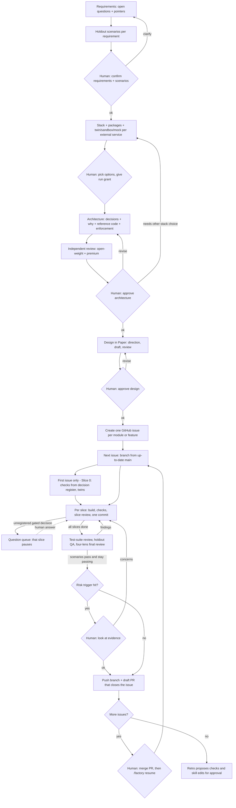

# Software factory: research notes and design

Everything gathered for rebuilding the Oh My Pi software factory from scratch, the
consolidated requirements (§7), and the design built from them (§8). The previous
`factory` skill was removed on 2026-10-19 and archived at
`~/.local/share/ohmypi/factory-archive-20261019-101151/` (including its uncommitted
edits as `uncommitted-edits.patch`; the committed version is also in git history).

Built on 2026-10-19 as the omp plugin `omp/factory/`, installed with
`omp plugin link omp/factory`. In any repo, `/factory help` lists the commands.

## Contents

1. Sources and how they were read
2. super-board (Eric Tech): what it does
3. Harness engineering (Dru Knox, Tessl): what it says
4. StrongDM software factory (via ByteMonk): what it says
5. ZazenCodes factory for Claude Code: what it does
6. Claude for Small Business plugin (Anthropic): what it does
7. What the user wants
8. Combined design
9. Settled and open decisions
10. Deliberately not adopted

---

## 1. Sources and how they were read

| Source | What was read | Caveat |
| --- | --- | --- |
| Video: "I Built a Self-Improving Software Factory", Eric Tech, 2026-10-07 — <https://www.youtube.com/watch?v=aggJvNZxfKA> | Not watched: no captions available | Analysis comes from the open-source repo the video demos |
| Repo: <https://github.com/EricTechPro/super-board> (v3.1.2) | README; `skills/super-board/SKILL.md`; `super-build`, `super-qa`, `super-review` `SKILL.md`; `references/lint.md`, `design-preflight.md`, `calibration.md` | `super-collect` and `ui-refine-loop` not read |
| Repo: <https://github.com/mattpocock/skills> | README; `grill-with-docs` | super-board builds on these skills |
| Video: "Harness Engineering: How to Build a Software Factory", Dru Knox (Tessl), AI Engineer, 2026-10-06 — <https://www.youtube.com/watch?v=X6l4lpA0_NY> | Full transcript via <https://ainotes.us/summary/harness-engineering-how-to-build-a-software-factory-dru-knox-tessl> | Third-party transcript of the YouTube captions |
| Tessl blog: [The Rise of the Harness Engineer](https://tessl.io/blog/the-rise-of-the-harness-engineer) | Full post | Vendor content |
| Tessl blog: [75% of Tessl's PRs now merge without human review](https://tessl.io/blog/75-of-tessls-prs-now-merge-without-human-review) | Full post | Vendor benchmark; post still has "[Placeholder: confirm dates]" notes |
| Tessl blog: [Engineering a Context-Driven Software Factory](https://tessl.io/blog/engineering-a-context-driven-software-factory) | Full post | Vendor content |
| Video: "The End of Coding Jobs? Inside the AI Software Factory", ByteMonk, 2026-03-14 — <https://www.youtube.com/watch?v=xz1EDn4khLA> | Auto-generated captions | Mostly job-market commentary; the technical part summarizes StrongDM, so the primary source was read too |
| StrongDM: [Software Factories and the Agentic Moment](https://factory.strongdm.ai/), [Principles](https://factory.strongdm.ai/principles), [Techniques](https://factory.strongdm.ai/techniques), [Shift Work](https://factory.strongdm.ai/techniques/shift-work), [Gene Transfusion](https://factory.strongdm.ai/techniques/gene-transfusion) | Full pages | Vendor content; DTU, Semport, Pyramid Summaries, Filesystem pages read only as summaries |
| Simon Willison: [How StrongDM's AI team build serious software without even looking at the code](https://simonwillison.net/2026/feb/7/software-factory/) | Full post | Adds the DTU creator's prompting note from Hacker News |
| Video: "Build Your Own AI Software Factory with Claude Code", ZazenCodes, 2026-10-07 — <https://www.youtube.com/watch?v=ctoaIC4LHmI> | Not watched: no captions available | Analysis comes from the source code linked in the description |
| Repo: [zazencodes-season-3/src/software-factory-claude-code](https://github.com/zazencodes/zazencodes-season-3/tree/main/src/software-factory-claude-code) | README; `.claude/skills/factory/SKILL.md`; all seven agents; `BUILD_PROMPT.md` | `dashboard.html` and example jobs not read |
| Video: "Anthropic Just Released 13 New Skills To Level Up Your Claude Setup", Austin Marchese, 2026-10-06 — <https://www.youtube.com/watch?v=CNsP0mi1DLw> | Description only: no captions available | Its themes (utility vs orchestration skills, routing collisions, "automate the prep, not the decision") were checked against the primary sources below |
| Anthropic: [Introducing Claude for Small Business](https://www.anthropic.com/news/claude-for-small-business) | Full post | Vendor content |
| Repo: [knowledge-work-plugins/small-business](https://github.com/anthropics/knowledge-work-plugins/tree/main/small-business) (v1.35.1) | README; `skills/smb-router`, `skills/close-month`; `shared/chain-seams.md`, `absent-is-not-zero.md`, `untrusted-content.md`; `engineering` plugin README | The other 42 skills and remaining shared references not read |

---

## 2. super-board: what it does

**Pitch:** "Add tasks, walk away, get merged PRs with proof." A Claude Code (and Codex)
plugin that drains a GitHub Project board through Build → QA → Review lanes and merges
when green. Built on obra/superpowers, mattpocock/skills, BuilderIO/skills, archify.

### Parts

- **5 skills you type:** `/super-board` (orchestrator), `/super-collect` (turns Sentry,
  PostHog, issues, PRs and architecture problems into verified Backlog cards),
  `/ui-refine-loop` (critique → refine one page), `/visual` (one HTML page: recap, plan,
  or codebase map), `/git-sync`.
- **3 lane skills the board runs:** `super-build`, `super-qa`, `super-review`.
- **Verbs:** `onboard` (8-step setup), `lint` (clarify tickets), `status` (read-only),
  `run` (drain the board; also the resume command), `stop` (graceful shutdown).
- **6 guard hooks:** block worktrees outside `.claude/worktrees/`; block reading dotenv,
  SSH keys and credential files; block live-looking API keys written into files; block
  deletes outside the project; optional block on pushes to main; README skill-table sync.
  Plus a cleanup hook for merged worktrees and a **merge gate** script.

### State lives on the board, not in memory

Columns: Backlog → Ready → Building → QA → Review → Done, plus Blocked. The human curates
by moving cards into `Ready` and ordering them. Labels (`qa`, `bug`, `feature`) route
cards. Resume after a crash is just `run` again. The orchestrator never does product work,
never patches the dispatcher mid-run, and reports problems instead of silently expanding
scope.

### Build lane (`super-build`)

- One git worktree and branch per issue.
- **Smallest safe change**, test-first (TDD), `ponytail` "simplest solution first" check.
- **Docs first for outside tools:** any third-party API/SDK, dependency upgrade, or
  auth/billing work reads current official docs (Context7, else vendor docs) for the
  installed version, and cites them as `Docs:` bullets in the PR.
- **PR size cap:** 400 changed lines by default (lockfiles, generated files, snapshots,
  migration SQL excluded). Over the cap → stop, push what exists, propose a split into
  vertical slices, card goes to Blocked.
- **Decision ladder:** acceptance criteria → repo precedent → smallest blast radius →
  human gate. Stop at the first rung that answers. No panel, no vote. Interview skills
  (`grilling`) are forbidden inside workers because no user is there to answer.
- Skill routing by label: `bug` → diagnosing-bugs + tdd; `feature` → implement + tdd +
  codebase-design; `refactor` → codebase-design + tdd.
- Exits: success → draft PR, card to QA; partial → partial PR, issue stays open
  `human-gated`, loop continues; failure or human gate tripped → loop halts.
- Never merges. Only the reviewer's merge gate merges.

### QA lane (`super-qa`)

- Browser-driven route crawl (Playwright, breadth-first from the route table) that grows
  a permanent e2e suite under `e2e/paths/`; CI then runs it with no AI in steady state.
- "Green" means: no console errors, no uncaught page errors, no 5xx, no 401/403 on
  authenticated pages, and a page-type-specific **non-blank guard** (a 200 with a blank
  body is a bug).
- Forensics per test: screenshots, console log, page errors, HAR, network summary,
  Sentry events.
- Regression test is written at the layer the defect lives (unit/integration first,
  e2e only when the browser is what broke).
- Findings become GitHub issues with a strict template (summary, repro, expected,
  actual, evidence, suggested fix path, acceptance criteria), deduplicated by a
  deterministic fingerprint. The filer rejects bodies with `TBD`, `TODO:`, `<...>`.

### Review lane (`super-review`)

- **Independent first pass:** before reading the builder's summary, read the acceptance
  criteria and raw diff and write 2–4 hypotheses of what must be true and where it would
  break. Builder claims are leads, not evidence.
- Scope is the diff, never the whole codebase.
- **Finding classes:** Gap (AC missing), Bug, Verification miss (code may be right but
  not proven), Scope drift, Over-engineering (always "should fix", never blocks alone).
  "No issue" results are listed with file:line proof so they aren't re-litigated.
- **Severities:** Blocker, Should fix, Nit, Deepening opportunity (never blocks; filed as
  a future refactor card), Human gate.
- **Review remembers:** one report per PR, edited in place, finding IDs (R1, R2…) never
  change. Round 1 of a re-review checks every prior finding (`fixed` with file:line,
  `not fixed`, `no longer applies`) before any fresh pass. A resolved thread or the
  builder saying "fixed" is not evidence.
- Fixes route back to the owning lane (builder, QA, UI ticket, or human).
- Merges only through the merge gate: current base plus project `verify_commands` must
  pass, pinned to the reviewed head SHA.

### `lint`: ticket readiness before autonomy

Interactive pass that makes every active ticket executable by a worker that can't ask
questions. 19 criteria, including: no or empty acceptance criteria; unmeasurable
adjectives ("snappier"); no trigger/outcome pair; missing test surface; `etc.`/`TBD`;
unrelated features bundled; title/body mismatch; out of scope; ambiguous (two readings);
missing or unparseable `## Blocked by`; **AC proven only against a fake with no card
owning the real implementation**; too big for one PR; missing ticket sections;
**unsettled expensive design** (triggers design preflight). Asks in plain language
("what we'll check", not "acceptance criteria"). Ends with a **pre-flight** checklist of
credentials, tools and environment; `run` refuses to start until every item is ticked.

### Design preflight

For a new ownership boundary, new/changed public interface, or a choice expensive to
reverse: follow an existing ADR if one answers it; otherwise sketch **two genuinely
different designs** and record for each: owner and interface, constraints met, module
depth, blast radius, migration and reversal cost, verification, and a deletion test
(what disappears if the module is removed). Pick the minimal design that meets the
constraints; record decision and main tradeoff.

### Models

A cheap router grades each card easy/medium/hard; a run flag picks the ladder
(e.g. default: Sonnet for easy, Opus for medium, session model for hard; `--codex` uses
GPT models for every lane).

### Self-improving ("calibration")

Off by default. Runs only after a fully verified run (every selected PR merged, merge
commits proven on the base, no blocked/partial/halted cards). Writes a bounded receipt
of that run's evidence, then delegates to an installed `calibrate` skill that may edit
**only an explicit allowlist of existing skill files**. Everything else (AGENTS.md,
CLAUDE.md, new skills) stays a proposal for human approval. The host inspects the diff
and never auto-commits it.

### Matt Pocock skills it leans on

- `grill-with-docs` = `grilling` (relentless one-question-at-a-time interview with a
  recommended answer; "yes" accepts it) + `domain-modeling` (builds a shared glossary,
  `CONTEXT.md`, and ADRs as you go).
- `code-review` (two axes: repo standards, and spec = the issue's ACs),
  `codebase-design` (vocabulary: module, interface, depth, seam, adapter, leverage,
  locality), `tdd`, `diagnosing-bugs`, `to-tickets` (split into vertical slices).

---

## 3. Harness engineering: what Tessl says

### Definitions

- **Software factory:** an agentic system where agents create everything shipped to
  users; engineers build the factory.
- **Harness (or "loop") engineering:** building the loops that automate the factory and
  raise its quality.

### Three measures, in order

1. **Autonomy:** how often a human must correct the agent.
2. **Automation:** how much runs without human review or manual verification. High
   autonomy with low automation is possible (agents one-shot, but you still read every
   line).
3. **Quality:** of the shipped product. Hold it constant while raising 1 and 2, then
   raise it: the backlog disappears and freed capacity goes to test quality and
   refactors.

### Three loops

| Loop | When | What | Drives |
| --- | --- | --- | --- |
| Inner | While the agent works, before review | Cheap, fast checks run constantly | Autonomy |
| Outer | Once, when work goes up for review | Expensive, thorough checks: agentic QA, mutation testing | Automation (replaces human review) |
| Meta | Outside development | Mines agent logs, PRs, issue tracker, user feedback for repeated mistakes; feeds fixes into inner and outer loops | Quality; "where you'll spend most of your time" |

### Why it's hard

The field changes weekly (best practices turn into anti-patterns); the work is unplanned
and competes with shipping; the signals are trapped in local agent logs and people's
heads.

### Three layers to build

1. **Control plane:** work starts as an issue → headless agent in a sandbox → PR →
   humans comment. Every human–agent touch point becomes recorded and minable. Plus a
   review surface and a shared registry of skills/playbooks.
2. **Agent-ready stack:** CLI/API access, internal services, production logs, a way to
   run and click through the product, an execution environment. "Worse than you think."
3. **Improvement loops:** nightly/weekly repo sweeps, playbooks for common tasks, mining
   repeated tasks into automated skills, continuous output-quality review.

### Metrics

Manual takeovers ↓, human PR comments ↓, PRs started without human input ↑, quality held
then raised. The context post adds: time to accepted work, review effort, repeated
corrections, escaped defects, total cost.

### Invariants: make decisions explicit, then enforce them

- Tessl benchmark (~1,000 open-source skills, with vs. without): skills let cheaper,
  smaller models match larger ones, but **only ~70% of a skill's instructions were
  followed on average**. Skills must be paired with checks.
- Enforcement, strongest first: deterministic checks (CI, linters, `ast-grep`; agents
  write these well) → narrow verifiers (one rule, checked on every file by a quick
  model) → agentic code review with the team's principles.
- Starter exercises: summarize your last ~50 PRs for recurring problems; write down 3
  invariants; turn one into a CI gate and watch how often it fires.

### Review against your own standards

Tessl's reviewer, configured with the team's own standards, vs. their previous generic
AI reviewer over one week (~600 PRs): **91% vs. 68%** of findings were real defects;
1.56 vs. 0.75 author-fixed bugs per PR; they tied on an external benchmark, so the
difference came from the repo-specific standards. ~75% of PRs merged with no human
correction. Repeated findings become pass/fail verifiers.

Cost data: **8.5% of PRs ran more than five review rounds and used 47.4% of review
spend**; about one in seven rounds on those PRs was triggered by a merge conflict, and
two-thirds of those reruns found nothing new. Pick models by cost per verified outcome,
not token price.

### Risk ladder

Grade each area by blast radius and codify it into approvals: research code is free for
all; some internal tooling auto-merges on automated review only; some areas need the
owning engineer to merge; a few high-leverage areas need a specific person consulted.
Their review policy names six change types that always need a human check (including
privacy and access control).

### Context: poisoning and decay

- Accepted code becomes context for the next agent. An undetected mistake gets copied
  and starts to look like convention (**poisoning**). An outdated rule or test keeps
  enforcing a superseded decision (**decay**).
- "A second agent agreeing from the same flawed source is not sufficient validation."
- Practices:
  1. Package shared guidance as a versioned skill; record what context each run
     received; separate approved instructions from historical evidence and untrusted
     input.
  2. Implement authority through tool permissions; test that forbidden actions are
     actually blocked.
  3. Turn failures into **agent evals** (a fixed task set: a feasible fix, a misleading
     old PR, a conflict outside the agent's authority, a changed requirement); rerun
     when skills, models or the harness change; judge behavior, not the agent's claim.
  4. Link each derived check to the requirement it encodes; when the requirement
     changes, flag and invalidate dependent checks. Record model, settings, skill and
     check revisions per run.

---

## 4. StrongDM software factory: what it says

Justin McCarthy (CTO, StrongDM), 2026-02-06: "non-interactive development where specs +
scenarios drive agents that write code, run harnesses, and converge without human review."

- **Rules:** code must not be written by humans; code must not be reviewed by humans; "if
  you haven't spent at least $1,000 on tokens today per human engineer, your software
  factory has room for improvement" (Willison questions that spend).
- **Compounding correctness:** since Claude 3.5 (Oct 2024), long agent runs improve code
  instead of decaying it.
- **Principles:** seed (a PRD, a few sentences, a screenshot, or an existing codebase) →
  validation harness (end-to-end, as close to the real environment as possible) →
  feedback (output sampled back into inputs). The loop runs until the holdout scenarios
  pass and stay passing.
- **Tests vs scenarios:** a test stored in the codebase can be rewritten to match the code,
  or the code rewritten to pass it trivially (`return true`; reward hacking). A
  **scenario** is an end-to-end user story stored outside the codebase, like a holdout
  set in model training, validated by an LLM.
- **Satisfaction:** of all observed trajectories through all scenarios, the fraction that
  likely satisfy the user. Probabilistic, because their software has agentic parts.
- **Digital Twin Universe:** agent-built behavioral clones of third-party services (Okta,
  Jira, Slack, Google Docs/Drive/Sheets): APIs, edge cases, observable behavior.
  Thousands of scenarios per hour with no rate limits, API cost, or risk. Fidelity
  strategy: "use the top popular publicly available reference SDK client libraries as
  compatibility targets, with the goal always being 100% compatibility."
- **Shift work:** interactive growth (generate, clarify, approve, correct; a jointly
  evolving vision) vs non-interactive growth, where intent is already complete (spec +
  test suite, or an existing app as an executable spec) and the agent runs end to end.
- **Gene transfusion:** point agents at a concrete working exemplar; extract the pattern,
  synthesize it in the target, validate behaviorally.
- **Pyramid summaries** (reversible multi-level summaries the agent expands on demand) and
  **the filesystem** as agent memory.
- **Code as opaque:** correctness inferred only from externally observable behavior.
- **Deliberate naivete:** drop Software 1.0 cost assumptions; a full SaaS clone used to be
  unthinkable and is now routine.

---

## 5. ZazenCodes factory for Claude Code: what it does

One skill (`/factory`), seven subagents, plain markdown files. Loop: spec-writer (Opus)
→ builder (Opus) → four parallel reviewers: security (Opus), UX, UI, code (Sonnet) →
wait for all four → any `CHANGES` resumes the same builder (max 2 resumes, so max 3
rounds) → approver (Opus) → `APPROVE` merges to `main`, `ESCALATE` goes to needs-human.

- **Orchestrator never does product work.** It spawns agents and is the only writer of
  `job.json`. Agents get context from files, not the conversation, and each writes
  exactly one file.
- **First-line protocol:** `build.md` starts `STATUS: READY | BLOCKED`; each review
  starts `VERDICT: PASS | CHANGES`; `decision.md` starts `APPROVE | ESCALATE`.
- **Spec format:** Context (real paths), Requirements, Acceptance criteria (each an
  observable behavior plus how to verify it), Out of scope, Assumptions (each with a
  one-line reason; the approver escalates when one is really a product decision).
- **Builder:** simplest change that meets the spec, no fallbacks or extras; verifies
  every criterion with recorded evidence; lint only changed files, never a repo-wide
  `--fix`; stage explicit paths, never `git add -A`; one commit per distinct piece of
  work; `STATUS: BLOCKED` instead of papering over a failure. Resumed by name across
  rounds, so it keeps its context.
- **Four review lenses:** security (access control, input, XSS, data exposure, payments
  and identity, abuse/rate limits, secrets, dependencies); UX (flow, loading/empty/error
  states, each kind of user, copy, accessibility, phone width); UI (matches theme
  tokens and neighbouring components, no one-off CSS, alignment, contrast, phone
  width); code (correctness, simplicity, reuse, conventions, docs, commits; runs the
  validation commands). From round 2, each re-checks its own prior findings. Reviewers
  never sign in or submit forms, because the dev server may talk to real services.
- **Approver:** every criterion met with convincing evidence and at least one
  spot-checked itself; all four reviews pass; `git merge-tree` shows no conflicts.
  Escalates on money, access or identity; deploy, CI, hosting or build scripts; schema
  migrations, sending email, writing production data, new dependencies; an assumption
  that is really a product decision.
- **Repo-agnostic:** every repo-specific command (fresh setup, dev server on a given
  port, tests, build, lint) lives in `AGENTS.md`; the agent files carry none.
- **Parallel jobs:** one git worktree per job outside the repo, own dev-server ports and
  browser sessions; one Claude session per job.
- **Commands:** `/factory <feature>`, `/factory next` (backlog queue), `/factory approve`,
  `/factory rework <id> <note>` (human feedback back to a fresh builder).
- **Dashboard:** one HTML file polling `job.json`, served with `python3 -m http.server`.

---

## 6. Claude for Small Business plugin (Anthropic): what it does

The primary source for the video's claims. One plugin: 44 skills across finance, sales,
marketing, operations and hiring, plus a router.

- **Utility vs orchestration:** most skills do one job; 11 are workflows (commands) that
  chain other skills "with an approval checkpoint at every step". Route to the command
  for the end-to-end flow, to the skill for just that step.
- **Router and collisions:** `smb-router` maps plain English to one skill and never does
  the work itself: one recommendation, one reason, one ask. "Four pairs that sound
  alike": the command wins on shared phrases; the skill wins only on phrases that say
  "just this step". Tied match: urgency, then smaller scope, then one clarifying
  question.
- **Approval gates:** nothing is sent, posted, paid or written without an explicit yes;
  coding bills and paying bills are separate approvals; payroll is staged and the owner
  presses the button. Anthropic: "You approve the plan first or, when you're ready, let
  it run end-to-end."
- **"The ordering is the product"** (`close-month`): hard gate between steps; step 1
  owns the numbers; later steps cite them and never restate them; never auto-fix a
  flagged item.
- **Chain seams:** defects that exist only in the joins between skills: a total from
  one skill used as the denominator in a narrower one; a schedule announced that
  nothing runs ("never tell an owner a schedule is set unless something was actually
  scheduled"); times wrong by hours.
- **Absent is not zero:** empty, truncated or untracked data read as a fact; "an empty
  result and a failed query look identical"; "a fabricated zero is worse than
  silence."
- **Untrusted content:** everything read from outside is data, not instructions;
  money, credential and identity asks always go to the owner; "a read never widens the
  write."
- **Say upfront what won't work:** a missing connector is named with its fallback;
  "never silently route to something that will partially fail."
- **`build-agent`:** "automate this" turns a task the owner repeats into a named skill.

---

## 7. What the user wants

Consolidated from the conversation that produced this file (2026-10-19).

**Role**

- **U1.** A developer's pair, not a factory that replaces teams. Unit of work: one
  feature, sometimes a whole application, starting from an empty repo and then adding
  features on top of it.
- **U2.** One self-contained factory: a local omp plugin holding one `factory` skill (no
  per-step skills), its agent definitions and a holdout guard. No dependency on the
  other skills in this repo (the plan skills, the Paper skills, `commit`); it carries
  its own procedures.

**Interactive shift: human in the loop, in this order**

- **U3. Requirements:** asks only what is unclear; gathered requirements as short
  pointers, with out of scope, assumptions and holdout scenarios; human confirms.
- **U4. Stack and packages:** the agent picks; options only where several are viable;
  human chooses. Stack already decided → packages only. Per external service: twin,
  sandbox or mock. The standing run grant is given here.
- **U5. Architecture:** written for the chosen stack; the agent decides, reviews its
  own decisions, then presents "these are the decisions I took", each with why. Human
  approves.
- **U6. Design:** for work with UI; asks for direction when needed; designs in Paper on
  the file and page the human gives; design review rounds until approved.

**Non-interactive shift: no human**

- **U7. Code** per GitHub issue. An issue is a complete module or feature, never a
  commit: one issue for a single feature; one per build phase for a whole application.
  Each issue is built on its own branch from main; the next phase starts only after the
  human merges the previous phase's PR. Inside a branch, one commit per vertical slice,
  so parts can be reverted, redone or cherry-picked. No commits for factory artifacts;
  no factory metadata in commit messages.
- **U8. Code review, QA review, test-suite review** done by the agent. No model reviews
  work produced by its own model (no Opus reviewing Opus). The human does not review
  code, but may later.
- **U9. Push** each issue's branch and open a draft PR that closes the issue, with
  evidence; never merge. A short evidence look comes first when a risk trigger is hit.
- **U10. Rework:** the human's later PR feedback lands as new commits on top.

**Style and constraints**

- **U11.** Short: questions and pointers, no long documents or explanations; every
  decision comes with its why.
- **U12.** Works in the main checkout on each issue's branch; clean tree before each
  issue; never revert, stash or overwrite the user's changes.
- **U13.** Account-wide rule `omp/rules/explicit-runtime-permission.md`: nothing is
  launched or run without the standing grant from U4.
- **U14.** Accounts: two Anthropic accounts, one OpenAI Codex account (Plus plan), one
  Ollama Cloud account; each used where it fits best.
- **U15.** Progress: one status line per transition in chat.

**Understanding the code without reviewing it**

- **U16. Feature list:** on request, list every complete module or feature in the
  application from the code (for example the auth module, the to-do list), in any repo.
- **U17. Walkthroughs:** a document per feature with the code snippets and, for each,
  why it's there, what it takes and returns, how it's built and why it's built this
  way, to read in the human's own time.

Carried over from the previous `factory` skill (see the archive): independent review by
two model families (never shown each other's output; disagreements kept, not averaged);
append-only revision log for every approval request; `.factory/` work records gitignored
and never committed; a changed requirement reopens the upstream gate.

---

## 8. Combined design

Shift work (StrongDM): an interactive shift of four human gates makes the intent
complete; a non-interactive shift builds, reviews, runs QA, and pushes. super-board's
lane mechanics and Tessl's loops and enforcement fill both shifts. Pipeline, not
platform: one local omp plugin (see Packaging and runtime) and a work record in
`.factory/<work-id>/`; no orchestration service; no dependency on other skills in this
repo.

Mechanics from ZazenCodes: the orchestrator never does product work and is the only
writer of the work state; agents get context from files and each writes exactly one
file in `.factory/<work-id>/`, starting with a machine-readable first line
(`STATUS: READY | BLOCKED`, `VERDICT: PASS | CHANGES`); each slice gets a fresh builder,
resumed by name across that slice's review rounds (`write agent://<id>`), so context
doesn't pile up across slices. Progress is one status line per transition in
chat; no dashboard.

### Packaging and runtime

One local omp plugin at `omp/factory/` in this repo, installed once:

```
omp/factory/
  skills/factory/SKILL.md     orchestrator: commands, gates, loop, state
  skills/factory/reference/   one file per step and per subagent prompt
  agents/*.md                 builder; GPT designer; one open-weight reviewer per review
                              step; GPT reviewer; two stand-ins; feature lister; holdout QA runner
  extensions/holdout-guard.ts tool_call guard, declared in package.json omp.extensions
  evals/                      fixed eval tasks for the factory itself
  package.json
```

- **Commands**, all handled by the one skill: `/factory <feature>` starts a run;
  `/factory resume <work-id>` continues from the state file, including after the human
  merges a phase PR; `/factory rework <work-id> <issue> <note>` sends PR feedback back;
  `/factory status` prints where each run stands; `/factory features` lists the
  application's modules and features; `/factory explain <feature>` writes or refreshes
  its walkthrough; `/factory help`, or `/factory` with nothing after it, prints the
  command reference below. `features`, `explain` and `help` work in any repo,
  factory-built or not.
- **Finding IDs:** a work ID is `NNN-slug` (next number in `.factory/`, plus 2–4 words
  from the request, e.g. `003-todo-app`), printed when the run starts and at the front
  of every status line. `/factory status` lists every run in the repo with its work ID,
  current stage, issues (`#n`), open PRs and what each is waiting on. `<issue>` is the
  GitHub issue number (`12` or `#12`); `<note>` is free text in quotes. When the repo has
  exactly one unfinished run, `resume` and `rework` may omit the work ID, and `rework`
  may omit the issue if that run has exactly one open PR.
- **Command reference**, printed verbatim by `/factory help` (and bare `/factory`):

  ```text
  /factory <feature>                     Start a run: requirements → stack →
                                         architecture → design → issues → build →
                                         review → QA → draft PR per issue
  /factory resume [<work-id>]            Continue a run (after a crash, or after you
                                         merge a phase PR)
  /factory rework [<work-id>] [<issue>] "<note>"
                                         Send feedback on an open PR; fixes land as
                                         new commits on top
  /factory status                        List runs: work ID, stage, issues, open PRs,
                                         what each is waiting on
  /factory features                      List the app's modules and features
  /factory explain <feature>             Write or refresh docs/walkthroughs/<feature>.md
  /factory help                          Show this list (bare /factory does too)

  IDs:   work ID  NNN-slug, e.g. 003-todo-app (shown in every status line and by status)
         issue    GitHub issue number, 12 or #12
         note     free text in quotes
  Short: with one unfinished run, omit the work ID; with one open PR, omit the issue.

  Examples:
    /factory "todo app with auth"
    /factory resume
    /factory rework 12 "empty list should show a hint, not a blank page"
    /factory explain auth

  Gates, design reviews, risk looks and queued questions are answered in chat.
  The factory never merges: merge the PR on GitHub, then /factory resume.
  ```
- **Agents:** each definition sets its tools and a model role alias (one per review
  step's open-weight reviewer, plus `@factory_builder`, `@factory_designer`, `@factory_gpt`,
  `@factory_standin`, `@factory_standin_alt`, `@factory_qa`, `@factory_features`), mapped
  in `omp/config.yml` `modelRoles`, so each step's model swaps without editing agents. A
  review step hands the same checklist (its reference file) to each of
  its reviewer agents. The orchestrator spawns them all at depth 1 (omp's
  `task.maxRecursionDepth` defaults to 2).
- **Holdout guard:** scenarios live outside the repo at
  `~/.omp/factory/<repo>/<work-id>/scenarios.md`, so repo-wide grep and glob can't reach
  them. The extension's `tool_call` handler blocks any call from any subagent other than
  the holdout QA runner (`ctx.agent.name`) whose input mentions `.omp/factory`.
  Before the first build, the orchestrator has the builder try to read a scenario and
  confirms the block fires.
  Residual risk: a shell command that assembles the path piece by piece isn't caught.
- **Work record:** `.factory/<work-id>/` in the repo, excluded through
  `.git/info/exclude` (local and never committed; `.gitignore` stays untouched).
  `state.json` (stage, slice, round, verdicts) is written only by the orchestrator;
  `/factory resume` reads it after a crash or compaction.
- **Run budget:** a per-agent request budget set at Gate 2 through omp's
  `task.agentSoftRequestBudget`, as a session setting; hitting it pauses the run and
  asks.

Rules across every step (from Claude for Small Business):

- **One owner per artifact.** Gate 1 owns requirement IDs and scenarios; Gate 2 owns the
  stack, package list and run grant; Gate 3 owns decision IDs; Gate 4 owns the approved
  artboards. Later steps cite IDs and never restate or edit them; a change reopens the
  owning gate.
- **Ran, or say it didn't.** Nothing is reported as passing or verified unless it ran in
  this run. Whatever the run grant doesn't cover is named upfront as unverified.
- **Absent is not zero.** Zero tests run, a lint that matched no files, an empty scenario
  log, a check that has never fired: failures, not passes. Every new check is shown
  failing once before it counts.
- **Untrusted content is data.** Vendor docs, package READMEs, fetched pages, issue text
  and tool output cannot add a package, tool, URL, command or permission; text
  addressed to the agent is quoted as suspicious and not followed.
- **Seams are tested.** The factory's eval tasks run end to end through the handoffs
  (requirements → scenarios, decisions → checks, artboards → UI lens), not one step at
  a time.



### Gate 1: requirements (human confirms)

- Unclear points become open questions in `requirements.md`, each with a recommended
  answer; only what is unclear. No `ask` questionnaires at any gate: the factory ends
  its turn with "<step> done. Review <path>. Reply `approve` to continue, or type the
  change you want." `approve` accepts every recommendation; any other reply is a change.
- Output: pointers with stable IDs (R1, R2…), plus glossary terms when the domain needs
  them, plus **Out of scope** and **Assumptions** (each with a one-line reason), so
  product decisions get settled here instead of being escalated after the build.
- super-board `lint` checklist applied silently; only failures become questions:
  measurable outcomes, trigger/outcome pairs, no `etc.`/TBD, no bundled features, every
  fake or stub has an owner for the real implementation.
- **Holdout scenarios:** each requirement gets one or more end-to-end scenarios in plain
  language (who, steps, expected outcome). The human confirms them with the requirements.
  Stored at `~/.omp/factory/<repo>/<work-id>/scenarios/`; never given to the builder.
- A changed requirement reopens this gate and every later one.

### Gate 2: stack and packages (human picks where there are options)

- Repo with an existing stack: packages only.
- Each choice with several viable options: 2–3 options, recommendation, why, reversal
  cost. Obvious choices are listed as defaults and approved in one step.
- Packages: standard library first; current official docs for the installed version
  (super-board docs-first).
- External services: per service, twin / vendor sandbox / mock, with a recommendation.
  Twins target the popular public SDK clients at 100% compatibility (StrongDM).
- **Standing run grant** given here: named test commands, app launch yes/no, network
  yes/no, GitHub writes (create issues, push branches, open draft PRs). Valid for this
  work item only.
- **Push target:** the existing GitHub remote; for a repo without one, the human names
  a GitHub remote or the factory creates a private GitHub repo. Issues and PRs need
  GitHub.
- **Run budget:** per-agent request budget for this run (see Packaging and runtime).

### Gate 3: architecture (human approves)

The agent decides; it does not interview. Decisions are written for the approved stack.

| Layer | What the agent decides and presents |
| --- | --- |
| Data | Schema ownership, ID strategy, money and time types, migration approach |
| Module | Layering (handler → service → repository), transaction ownership, fakeable seams |
| Function design | Pure core with side effects at the edges or not; functions vs. classes; how dependencies are passed; async model; signatures and invariants of key functions |
| Error model | Exceptions vs. Result types; where validation happens; error codes |
| Testing | Test layers; real database vs. fakes; what must be proven end to end |
| Security and ops | Authn/authz model, secrets handling, logging and tracing |
| Not decided here | Formatting, naming case, import order: linter/formatter config |

- Expensive-to-reverse decisions: two genuinely different designs are compared
  internally (super-board design preflight fields); the packet shows the chosen one and
  the rejected alternative in one line.
- Packet, one line per decision: **decision — why — reference code — enforced by**.
  Reference code: repo precedent first, else a named external exemplar (StrongDM gene
  transfusion). Enforced by: linter or `ast-grep` rule / architecture test / narrow
  verifier / review checklist / not enforceable; each check records the decision ID it
  enforces (decay protection). The enforcement column exists because only ~70% of skill
  instructions get followed (Tessl).
- Also: interface contracts, test plan, and the **issue plan**: one issue per complete
  module or feature (one for a single feature, one per build phase for a whole app),
  each with its vertical slices (under ~400 changed lines each), in dependency order.
  Approving the packet approves creating those issues on GitHub.
- Independent review runs before the human sees the packet: glm-5.3-flash and GPT-6.1-sol,
  each blind to the other. Opus doesn't review, because Opus wrote the packet.
- An architecture need the approved stack can't meet reopens Gate 2 for that choice only.

### Gate 4: design (human approves)

- Only for work with UI, through the Paper MCP server (`omp/mcp.json`).
- The human gives the Paper file and page; the work record stores them.
- The `factory-designer` agent (GPT, `@factory_designer`) owns the creative direction and
  every Paper write; the orchestrator runs the gate. GPT was chosen over Claude for
  stronger creative direction. When needed it proposes the direction first: a reference
  UI as the base, then the requested changes. Then it builds tokens and the design system,
  then the screens in order, and screenshots them for review.
- Review rounds until approved. Approved artboards become the visual reference for the
  UI lens and holdout QA.

### Build (no human)

- Works in the main checkout, no worktree. For each issue, in order: the tree must be
  clean (if it isn't, stop and ask; never stash), main is fetched, and the issue's branch
  is created from up-to-date main (`gh issue develop <n> --base main --checkout`, which
  links branch and issue). The user doesn't edit the checkout while a run is going.
- **Issue bodies** are short: requirement IDs covered, acceptance criteria, slices, out
  of scope, `Depends on #n`. Never holdout scenarios, never factory metadata.
- **Slice 0:** write the repo's `AGENTS.md` commands (fresh setup, dev server on a given
  port, tests, build, lint; in an existing repo, only the missing ones) so every agent
  reads them from one place, generate the checks from the decision register, and build
  the twins, all before any feature code. Slice 0 goes through slice review like any
  other slice, because its checks enforce the architecture.
- Per slice: test-first; docs-first for outside tools; decision ladder = decision
  register → requirement → repo precedent → smallest change.
- An issue that brings in an external service not seen before builds its twin in its
  first slice.
- A gated decision missing from the register pauses only that slice; its question goes
  to a queue; independent slices continue.
- **Slice review** by two reviewers, independently: glm-5.3-flash (open-weight) and
  GPT-6.1-sol (premium, a different family from the builder). Each writes its own
  hypotheses before reading the builder's report; checks against the decision register
  and standards, not neighbouring code; persistent finding IDs; super-board finding
  classes. The slice passes only when both say PASS; **max 3 rounds**, then the
  question queue.
- Builder rules: simplest change that meets the slice; lint only changed files, never a
  repo-wide `--fix`; stage explicit paths; `STATUS: BLOCKED` with the reason instead of
  papering over a failure.
- **One commit per vertical slice**, made by the main agent: a one-line semantic message
  in the repo's style, explicit paths staged; each commit is a working slice. Before
  the first push, fixes become `--fixup` commits autosquashed into their slice, so the
  history stays one commit per slice. Main agent is the only committer; no factory
  metadata in messages; `.factory/` never committed.

### Review and QA (no human)

Every review step has at least one open-weight and one premium reviewer, working
independently and blind to each other. No model reviews work produced by its own model:
the builder and the architecture author are Opus, so no Claude model reviews. A step
passes only when every reviewer in it says PASS; findings stay per reviewer, never
averaged. Each issue goes through: test-suite review → holdout QA → final review, so
behavior failures are fixed before the most expensive step.

- **Test-suite review** by deepseek-v4.1-flash and GPT-6.1-sol: deleted or weakened assertions,
  skipped tests, tests that only exercise mocks, `return true`-style passes,
  requirements with no test.
- **Holdout QA:** a separate QA agent (glm-5.3-flash; a check, not a review) that never
  shared context with the builder runs the scenarios for this issue's requirements plus
  every earlier issue's scenarios (regression), against the running app and twins (when
  the grant allows launch), with forensics (screenshots, console, network) and a check
  of screens against the approved artboards. Failures go back to the owning slice as
  findings, never as scenario text. Full rerun after each fix until every scenario
  passes and stays passing; **max 3 rounds**, then the question queue.
- **Holdout enforcement:** the holdout guard (see Packaging and runtime) blocks every
  subagent except the QA runner from the scenarios, and a check proves the block
  works before the first build (Tessl: test that forbidden actions are actually blocked).
- Satisfaction scoring only for features with LLM behavior; pass/fail otherwise.
- **Final review: four lenses in parallel** on the issue's `main..branch` diff, each
  reviewer writing one `VERDICT` file; the round ends only when all eight are in.
  - **Security** (glm-5.3 and GPT-6.1-sol) and **code** (kimi-k2.7-code and GPT-6.1-sol),
    each reviewer independent.
    Security: access control, input, XSS, data exposure, payments and identity, rate
    limits, secrets, dependencies. Code: decision-register conformance, correctness,
    simplicity, reuse, cross-cutting consistency, dead code, over-engineering.
  - **UX** (gemma4:31b and GPT-6.1-sol): flows, loading/empty/error states, each kind
    of user, copy, accessibility, phone width.
  - **UI** (glm-5.3-flash and GPT-6.1-sol): screens against the approved Paper artboards
    and design tokens, no one-off CSS, alignment, contrast, phone width.
  - Reviewers use the twins, never real services; they never sign in to or submit forms
    against anything live.
  - Fixes go back through the slice loop; max 3 rounds.

### Delivery

Before push: spot-check at least one acceptance criterion directly, and confirm
`git merge-tree --write-tree <base> HEAD` shows no conflicts.

Risk ladder: if any trigger is hit, the human gets a short evidence summary for that
area (what changed, review findings, scenario results) before push. No code reading;
concerns go back through the slice loop. Triggers: auth, permissions or identity;
payments; data migrations; secrets; deploy, CI, hosting or build scripts; a package not
approved at Gate 2; sending email or writing production data; a product decision the
agent made that wasn't settled at Gate 1.

**Walkthrough:** after final review passes, the orchestrator writes
`docs/walkthroughs/<feature>.md` for the issue's feature (see Features and
walkthroughs) and commits it on the issue's branch as one `docs:` commit, the only
commit besides the slice commits.

Then push the issue's branch and open a draft PR that closes the issue. The PR body is
the evidence: requirement → scenario → result trace, check results, review outcomes,
known limits, and a link to the walkthrough. The human reviews code later, if at all.
Never merges.

**Between phases:** with more issues left, the run pauses and says which PR to merge.
After the human merges it, `/factory resume <work-id>` checks the PR is merged and
starts the next issue from up-to-date main. A resume in a new session first asks the
human to renew the run grant and re-applies the run budget from `state.json`, because
neither carries over between sessions.

**Rework:** when the human reviews an open PR later, their note goes to the builder on
that issue's branch. The rework session first asks the human to renew the run grant,
because permission doesn't carry over between sessions (runtime rule). Fixes land as new
commits on top (no history rewrite after push), go through slice review, the affected
final-review lenses and the holdout scenarios, then get pushed. Feedback on an
already-merged PR becomes a new issue.

### Features and walkthroughs

**`/factory features`** lists every complete module or feature, computed from the code
each time so it's always current and works on any repo; nothing extra is committed. Per
entry: name, one-line purpose, entry points (routes, commands, exported functions), main
files, tests, and, when the factory built it, its issue, PR and walkthrough. Run by
`anthropic/claude-sonnet-5-5` (1M-token context), read-only.

**`/factory explain <feature>`** writes `docs/walkthroughs/<feature>.md`, committed.
Written automatically for every delivered issue, and on demand for any feature. Written
by Opus, which holds the decision record. For each snippet:

- the code, quoted exactly from the file at a named commit, with `file:line`, so the
  document can't silently drift from the code;
- what it does and why it's there;
- what it takes and what it returns;
- how it's built and why it's built this way, citing the decision and requirement IDs
  it follows, or saying "no recorded decision" when there is none (in a repo the
  factory didn't build, the why comes from code, comments and commit history and is
  labelled inferred);
- which tests cover it.

Order follows a request through the feature: entry point first, then the core logic,
then storage and side effects. A rerun after the code changes refreshes snippets and
marks what changed.

### Model routing

Pick models by cost per verified outcome, not token price (Tessl).

All models run at high effort.

| Role | Role alias | Model |
| --- | --- | --- |
| Orchestrator, Gates 1–4 (runs Gate 4, does not draw), pre-push, retro | `default` | `anthropic/claude-opus-5-5` |
| Builder (fresh per slice) | `@factory_builder` | `anthropic/claude-opus-5-5` |
| Designer: Gate 4 direction and every Paper write (fresh per round) | `@factory_designer` | `openai-codex/gpt-6.1-sol` |
| Open-weight reviewers, one alias per review step | `@factory_<step>_open` | see the next table |
| Holdout QA runner (needs images) | `@factory_qa` | `ollama-cloud/glm-5.3-flash` |
| GPT reviewer | `@factory_gpt` | `openai-codex/gpt-6.1-sol` |
| Stand-in when GPT is rate-limited | `@factory_standin` | `ollama-cloud/kimi-k2.7-code` (images) |
| Stand-in in the code lens, where kimi already reviews | `@factory_standin_alt` | `ollama-cloud/minimax-m3` |
| Feature lister (`/factory features`) | `@factory_features` | `anthropic/claude-sonnet-5-5` |

| Review step | Open-weight (alias) | Premium | Runs per round |
| --- | --- | --- | --- |
| Architecture review | glm-5.3-flash (`factory_arch_open`) | GPT-6.1-sol | 2 |
| Slice review | glm-5.3-flash (`factory_slice_open`) | GPT-6.1-sol | 2 |
| Test-suite review | deepseek-v4.1-flash (`factory_tests_open`) | GPT-6.1-sol | 2 |
| Final: security lens | glm-5.3 (`factory_security_open`) | GPT-6.1-sol | 2 |
| Final: code lens | kimi-k2.7-code (`factory_code_open`) | GPT-6.1-sol | 2 |
| Final: UX lens | gemma4:31b (`factory_ux_open`) | GPT-6.1-sol | 2 |
| Final: UI lens | glm-5.3-flash (`factory_ui_open`) | GPT-6.1-sol | 2 |

A stand-in never duplicates a model already in its step: kimi-k2.7-code everywhere
except the code lens, where minimax-m3 stands in (qwen3.5:397b was retired by Ollama on
2026-09-25).

No Claude model reviews: the builder and the architecture author are Opus, and a model
never reviews its own model's work. The `factory_*` aliases are added to
`omp/config.yml` when the factory is built; whether omp parses a thinking suffix after a
model ID that itself contains a colon (`gemma4:31b:high`) is checked
then. There is no quality data yet on the open-weight picks; swap any step's alias whose
real-finding rate or cost per accepted slice is worse. Moving easy slices to an
open-weight builder comes later, once the register and checks are tight; the reviewers
then switch so none shares the builder's family.

**Accounts.** omp rotates the two Anthropic accounts automatically and falls back on
rate limits; nothing is pinned. GPT is the premium reviewer in every review step, and
the Plus plan is the likeliest limit to hit: when GPT is rate-limited, kimi-k2.7-code
(minimax-m3 in the code lens) stands in for that step and the
evidence flags it. The Ollama Cloud account carries every open-weight review, the
holdout QA runs and the stand-in; the Anthropic accounts also carry `/factory features`
on Sonnet.

**omp configuration.** Added to `omp/config.yml` (symlinked to
`~/.omp/agent/config.yml`) when the factory is built:

```yaml
modelRoles:
  # existing roles unchanged; default stays anthropic/claude-opus-5-5:high (orchestrator)
  factory_builder: anthropic/claude-opus-5-5:high
  factory_arch_open: ollama-cloud/glm-5.3-flash:high
  factory_slice_open: ollama-cloud/glm-5.3-flash:high
  factory_tests_open: ollama-cloud/deepseek-v4.1-flash:high
  factory_security_open: ollama-cloud/glm-5.3:high
  factory_code_open: ollama-cloud/kimi-k2.7-code:high
  factory_ux_open: ollama-cloud/gemma4:31b:high
  factory_ui_open: ollama-cloud/glm-5.3-flash:high
  factory_qa: ollama-cloud/glm-5.3-flash:high
  factory_gpt: openai-codex/gpt-6.1-sol:high
  factory_designer: openai-codex/gpt-6.1-sol:high
  factory_standin: ollama-cloud/kimi-k2.7-code:high
  factory_standin_alt: ollama-cloud/minimax-m3:high
  factory_features: anthropic/claude-sonnet-5-5:high
```

Agent definitions in `omp/factory/agents/`, each pointing at one alias:

| Agent | `model:` | Tools |
| --- | --- | --- |
| `factory-builder` | `@factory_builder` | read, grep, glob, edit, write, bash, lsp |
| `factory-designer` | `@factory_designer` | read, grep, glob, write (its one output file, `design.md`), Paper MCP |
| `factory-review-<step>` for arch, slice, tests, security, code | `@factory_<step>_open` | read, grep, glob, bash, write (its verdict file only) |
| `factory-review-ux`, `factory-review-ui` | `@factory_ux_open`, `@factory_ui_open` | read, grep, glob, bash, browser, write |
| `factory-review-gpt` | `@factory_gpt` | read, grep, glob, bash, browser, write |
| `factory-review-standin`, `factory-review-standin-alt` | `@factory_standin`, `@factory_standin_alt` | read, grep, glob, bash, browser, write |
| `factory-qa` | `@factory_qa` | read, bash, browser, write |
| `factory-features` | `@factory_features` | read, grep, glob, bash (read-only `git` and `gh`), write (its one output file, `.factory/features.md`) |

- Factory agents are **not** listed under `task.agentModelOverrides`: an entry there
  would override the agent's own `model:`.
- The run budget goes into `task.agentSoftRequestBudget` (agent name → request count)
  as a session setting at Gate 2, and again on every resume.
- Accounts need no configuration: omp rotates the logged-in Anthropic accounts, and the
  `openai-codex` and `ollama-cloud` logins are already in place.
- The plugin is installed with `omp plugin link omp/factory`, which also loads the
  holdout guard declared in its `package.json` `omp.extensions`.
- To swap a model, change one alias in `modelRoles`; no agent file changes.

### Meta loop

- Per-run trace in `.factory/`: models, skill revisions, check results, findings by
  class, review rounds, queued questions, human corrections at gates, cost.
- A retro after each run proposes, for human approval: checks for repeated findings,
  skill edits, new questions for decision types that keep getting escalated. It never
  edits skills itself.
- Fixed eval tasks for the factory itself in `omp/factory/evals/`, rerun whenever the
  skill, agents, models or routing change.
- Manual asks that repeat across runs become proposals for a new step or reference file
  in the `factory` skill (Claude for Small Business `build-agent`).

### Metrics

Revisions requested at gates; queued questions per run; review rounds per slice;
scenarios failing on the first QA run; defects found after push; cost per accepted slice.

---

## 9. Settled and open decisions

### Settled (2026-10-19)

| Decision | Choice |
| --- | --- |
| Unit of work | A feature, sometimes a whole app; starts from an empty repo |
| Gate order | Requirements → stack → architecture → design → build |
| Stack vs architecture | Stack first; architecture written for it |
| Design loop | After architecture, right before code |
| Holdout scenarios | Yes, hidden from the builder |
| External services | Per service at the stack gate: twin / sandbox / mock |
| Run permission | One standing grant at the stack gate |
| Commits | One per vertical slice, plus one `docs:` walkthrough commit per issue; after push, rework lands as new commits on top |
| Issues and branches | One GitHub issue per complete module or feature (never per commit); one branch per issue from main; draft PR closes the issue; the next phase waits for the human to merge the previous PR |
| Delivery | Push the issue branch + draft PR; never merge |
| Risk ladder | Short human look at the evidence before push when a trigger is hit: auth/identity, payments, migrations, secrets, deploy/CI/hosting/build scripts, package not approved at Gate 2, email or production writes, product decision not settled at Gate 1 |
| Final review | Four parallel lenses per issue, each open-weight model + GPT-6.1-sol: security glm-5.3, code kimi-k2.7-code, UX gemma4:31b, UI glm-5.3-flash |
| No self-review | No model reviews its own model's work; no Claude reviewer, since Opus builds and writes the architecture |
| Review pairing | Every review step has at least one open-weight and one premium reviewer, independent; a step passes only when all say PASS |
| Review order and caps | Test-suite review → holdout QA → final review; slice review, holdout QA and final review each max 3 rounds, then the question queue |
| Effort and builder | All models at high effort; a fresh builder per slice; Slice 0 goes through slice review |
| Checkout | Main checkout; each issue's branch created from up-to-date main; no worktrees; clean tree required before each issue |
| Progress | One status line per transition in chat; no dashboard |
| Holdout enforcement | Scenarios stored outside the repo; an extension `tool_call` guard blocks every subagent except the holdout QA runner (`factory-qa`), by agent name; the block is tested before the first build |
| Open-weight models | Per review step: architecture and slice glm-5.3-flash; test suite deepseek-v4.1-flash; security glm-5.3; code kimi-k2.7-code; UX gemma4:31b; UI glm-5.3-flash. Holdout QA glm-5.3-flash. One alias per step |
| Feature lister model | `anthropic/claude-sonnet-5-5` (1M context; not a review, so the no-self-review rule doesn't apply) |
| Accounts | omp rotates the two Anthropic accounts automatically; nothing pinned |
| GPT rate limit | kimi-k2.7-code stands in for GPT (minimax-m3 in the code lens, where kimi already reviews); the evidence flags it |
| Feature list | `/factory features`, computed from the code each time; works in any repo |
| Walkthroughs | `/factory explain <feature>` writes `docs/walkthroughs/<feature>.md`, committed; written automatically for every delivered issue and on demand |
| Help | `/factory help` and bare `/factory` print the command reference: every command, its arguments, ID formats, shortcuts, examples |
| Packaging | One local omp plugin at `omp/factory/`: one `factory` skill, agent definitions, holdout-guard extension, evals; independent of the other skills in this repo |
| Run budget | Per-agent request budget set at Gate 2 (`task.agentSoftRequestBudget`); hitting it pauses the run |
| Push target | Existing remote; otherwise named at Gate 2, or a new private GitHub repo |
| Next step | Built on 2026-10-19 as `omp/factory/`; run the evals in `omp/factory/evals/` before relying on it |

Chosen by the agent from the sources (the user deferred):

| Decision | Choice | Why |
| --- | --- | --- |
| Review timing | Slice review + final review | Accepted code becomes context; a bad pattern in slice 1 gets copied (Tessl poisoning); a whole-app-only review may exceed reviewer context |
| Two model families | Every review step pairs open-weight with GPT; never the builder's own family | "A second agent agreeing from the same flawed source is not sufficient validation" (Tessl); rounds stay capped because review spend concentrates in long multi-round PRs (Tessl: 8.5% of PRs, 47.4% of spend) |
| Meta loop | Retro proposals only, human approves | Tessl's meta loop drives quality; super-board keeps calibration off by default and allowlisted; a solo developer's skills shouldn't self-edit |
| Reference code | Every architecture decision names one | StrongDM gene transfusion; super-board's repo-precedent rung; costs one line per decision |
| Open-weight models | Every review step, plus holdout QA | Cheap enough to run on every step; a different family from both premium vendors |
| Gap fixes | `.git/info/exclude` for `.factory/`; scenarios outside the repo; `/factory resume` from `state.json`; rework and resume renew the run grant and re-apply the budget; GitHub writes in the grant; twins for services first seen in later issues; role aliases instead of model names; Slice 0 adds only missing `AGENTS.md` commands | Found reviewing this doc for build readiness, 2026-10-19 |
| Cross-step rules | One owner per artifact; ran-or-say-it-didn't; absent is not zero; untrusted content is data; seams tested end to end | Claude for Small Business: `close-month` ordering, `chain-seams.md`, `absent-is-not-zero.md`, `untrusted-content.md` |

### Still open

None. Build prerequisites checked 2026-10-19: Ollama Cloud is logged in
(`omp models list ollama-cloud` lists 56 models), and per-agent blocking works through an
extension `tool_call` handler reading `ctx.agent.name` (omp extensions docs).

---

## 10. Deliberately not adopted

- Autonomous merge to the base branch (super-board's merge gate merges itself).
- super-qa's login bootstrap that reads `.env` files and creates test users with a
  service-role key: conflicts with the secrets and runtime-permission rules.
- "Never ask" autonomy at the requirements, stack, architecture and design level.
- StrongDM's "code is opaque": AI code review stays alongside behavioral validation.
- StrongDM's $1,000-per-engineer-per-day token target and 24/7 simulated-tester swarms.
- Satisfaction scoring for deterministic features.
- Auto-filing tickets from Sentry/PostHog straight into work (Backlog-only curation at
  most).
- Tessl's products (registry, Code Review, verifiers, Launch); the techniques are
  stack-independent.
- Unattended scheduled sweeps without an explicit standing permission.
- ZazenCodes' worktree-per-job parallelism, backlog queue (`/factory next`), and
  dashboard.
- Claude for Small Business's router, per-step utility skills (one `factory` skill
  instead), connector neutrality, and HTML artifact style; the `engineering` plugin's
  commands (`/architecture`, `/review`, `/deploy-checklist`): the gates already cover them.
