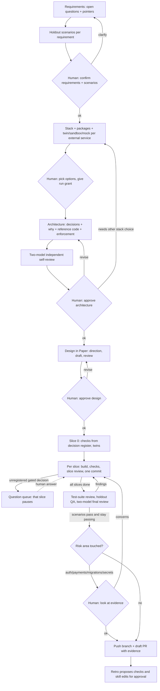

# Software factory: research notes and design starting point

One place for everything gathered before rebuilding the Oh My Pi software factory
from scratch. The previous `factory` skill was removed on 2026-10-19 and archived at
`~/.local/share/ohmypi/factory-archive-20261019-101151/` (including its uncommitted
edits as `uncommitted-edits.patch`; the committed version is also in git history).

To start: open a new chat in this repository and say what to build, pointing the
agent at this file.

## Contents

1. Sources and how they were read
2. super-board (Eric Tech): what it does
3. Harness engineering (Dru Knox, Tessl): what it says
4. StrongDM software factory (via ByteMonk): what it says
5. What the user wants
6. Combined design
7. Settled and open decisions
8. Deliberately not adopted

---

## 1. Sources and how they were read

| Source | What was read | Caveat |
| --- | --- | --- |
| Video: "I Built a Self-Improving Software Factory", Eric Tech, 2026-10-07 — <https://www.youtube.com/watch?v=aggJvNZxfKA> | Not watched: no captions available | Analysis comes from the open-source repo the video demos |
| Repo: <https://github.com/EricTechPro/super-board> (v3.1.2) | README; `skills/super-board/SKILL.md`; `super-build`, `super-qa`, `super-review` `SKILL.md`; `references/lint.md`, `design-preflight.md`, `calibration.md` | `super-collect` and `ui-refine-loop` not read |
| Repo: <https://github.com/mattpocock/skills> | README; `grill-with-docs` | super-board builds on these skills |
| Video: "Harness Engineering: How to Build a Software Factory", Dru Knox (Tessl), AI Engineer, 2026-10-06 — <https://www.youtube.com/watch?v=X6l4lpA0_NY> | Full transcript via <https://ainotes.us/summary/harness-engineering-how-to-build-a-software-factory-dru-knox-tessl> | Third-party transcript of the YouTube captions |
| Tessl blog: [The Rise of the Harness Engineer](https://tessl.io/blog/the-rise-of-the-harness-engineer) | Full post | Vendor content |
| Tessl blog: [75% of Tessl's PRs now merge without human review](https://tessl.io/blog/75-of-tessls-prs-now-merge-without-human-review) | Full post | Vendor benchmark; post still has "[Placeholder: confirm dates]" notes |
| Tessl blog: [Engineering a Context-Driven Software Factory](https://tessl.io/blog/engineering-a-context-driven-software-factory) | Full post | Vendor content |
| Video: "The End of Coding Jobs? Inside the AI Software Factory", ByteMonk, 2026-03-14 — <https://www.youtube.com/watch?v=xz1EDn4khLA> | Auto-generated captions | Mostly job-market commentary; the technical part summarizes StrongDM, so the primary source was read too |
| StrongDM: [Software Factories and the Agentic Moment](https://factory.strongdm.ai/), [Principles](https://factory.strongdm.ai/principles), [Techniques](https://factory.strongdm.ai/techniques), [Shift Work](https://factory.strongdm.ai/techniques/shift-work), [Gene Transfusion](https://factory.strongdm.ai/techniques/gene-transfusion) | Full pages | Vendor content; DTU, Semport, Pyramid Summaries, Filesystem pages read only as summaries |
| Simon Willison: [How StrongDM's AI team build serious software without even looking at the code](https://simonwillison.net/2026/feb/7/software-factory/) | Full post | Adds the DTU creator's prompting note from Hacker News |

---

## 2. super-board: what it does

**Pitch:** "Add tasks, walk away, get merged PRs with proof." A Claude Code (and Codex)
plugin that drains a GitHub Project board through Build → QA → Review lanes and merges
when green. Built on obra/superpowers, mattpocock/skills, BuilderIO/skills, archify.

### Parts

- **5 skills you type:** `/super-board` (orchestrator), `/super-collect` (turns Sentry,
  PostHog, issues, PRs and architecture problems into verified Backlog cards),
  `/ui-refine-loop` (critique → refine one page), `/visual` (one HTML page: recap, plan,
  or codebase map), `/git-sync`.
- **3 lane skills the board runs:** `super-build`, `super-qa`, `super-review`.
- **Verbs:** `onboard` (8-step setup), `lint` (clarify tickets), `status` (read-only),
  `run` (drain the board; also the resume command), `stop` (graceful shutdown).
- **6 guard hooks:** block worktrees outside `.claude/worktrees/`; block reading dotenv,
  SSH keys and credential files; block live-looking API keys written into files; block
  deletes outside the project; optional block on pushes to main; README skill-table sync.
  Plus a cleanup hook for merged worktrees and a **merge gate** script.

### State lives on the board, not in memory

Columns: Backlog → Ready → Building → QA → Review → Done, plus Blocked. The human curates
by moving cards into `Ready` and ordering them. Labels (`qa`, `bug`, `feature`) route
cards. Resume after a crash is just `run` again. The orchestrator never does product work,
never patches the dispatcher mid-run, and reports problems instead of silently expanding
scope.

### Build lane (`super-build`)

- One git worktree and branch per issue.
- **Smallest safe change**, test-first (TDD), `ponytail` "simplest solution first" check.
- **Docs first for outside tools:** any third-party API/SDK, dependency upgrade, or
  auth/billing work reads current official docs (Context7, else vendor docs) for the
  installed version, and cites them as `Docs:` bullets in the PR.
- **PR size cap:** 400 changed lines by default (lockfiles, generated files, snapshots,
  migration SQL excluded). Over the cap → stop, push what exists, propose a split into
  vertical slices, card goes to Blocked.
- **Decision ladder:** acceptance criteria → repo precedent → smallest blast radius →
  human gate. Stop at the first rung that answers. No panel, no vote. Interview skills
  (`grilling`) are forbidden inside workers because no user is there to answer.
- Skill routing by label: `bug` → diagnosing-bugs + tdd; `feature` → implement + tdd +
  codebase-design; `refactor` → codebase-design + tdd.
- Exits: success → draft PR, card to QA; partial → partial PR, issue stays open
  `human-gated`, loop continues; failure or human gate tripped → loop halts.
- Never merges. Only the reviewer's merge gate merges.

### QA lane (`super-qa`)

- Browser-driven route crawl (Playwright, breadth-first from the route table) that grows
  a permanent e2e suite under `e2e/paths/`; CI then runs it with no AI in steady state.
- "Green" means: no console errors, no uncaught page errors, no 5xx, no 401/403 on
  authenticated pages, and a page-type-specific **non-blank guard** (a 200 with a blank
  body is a bug).
- Forensics per test: screenshots, console log, page errors, HAR, network summary,
  Sentry events.
- Regression test is written at the layer the defect lives (unit/integration first,
  e2e only when the browser is what broke).
- Findings become GitHub issues with a strict template (summary, repro, expected,
  actual, evidence, suggested fix path, acceptance criteria), deduplicated by a
  deterministic fingerprint. The filer rejects bodies with `TBD`, `TODO:`, `<...>`.

### Review lane (`super-review`)

- **Independent first pass:** before reading the builder's summary, read the acceptance
  criteria and raw diff and write 2–4 hypotheses of what must be true and where it would
  break. Builder claims are leads, not evidence.
- Scope is the diff, never the whole codebase.
- **Finding classes:** Gap (AC missing), Bug, Verification miss (code may be right but
  not proven), Scope drift, Over-engineering (always "should fix", never blocks alone).
  "No issue" results are listed with file:line proof so they aren't re-litigated.
- **Severities:** Blocker, Should fix, Nit, Deepening opportunity (never blocks; filed as
  a future refactor card), Human gate.
- **Review remembers:** one report per PR, edited in place, finding IDs (R1, R2…) never
  change. Round 1 of a re-review checks every prior finding (`fixed` with file:line,
  `not fixed`, `no longer applies`) before any fresh pass. A resolved thread or the
  builder saying "fixed" is not evidence.
- Fixes route back to the owning lane (builder, QA, UI ticket, or human).
- Merges only through the merge gate: current base plus project `verify_commands` must
  pass, pinned to the reviewed head SHA.

### `lint`: ticket readiness before autonomy

Interactive pass that makes every active ticket executable by a worker that can't ask
questions. 19 criteria, including: no or empty acceptance criteria; unmeasurable
adjectives ("snappier"); no trigger/outcome pair; missing test surface; `etc.`/`TBD`;
unrelated features bundled; title/body mismatch; out of scope; ambiguous (two readings);
missing or unparseable `## Blocked by`; **AC proven only against a fake with no card
owning the real implementation**; too big for one PR; missing ticket sections;
**unsettled expensive design** (triggers design preflight). Asks in plain language
("what we'll check", not "acceptance criteria"). Ends with a **pre-flight** checklist of
credentials, tools and environment; `run` refuses to start until every item is ticked.

### Design preflight

For a new ownership boundary, new/changed public interface, or a choice expensive to
reverse: follow an existing ADR if one answers it; otherwise sketch **two genuinely
different designs** and record for each: owner and interface, constraints met, module
depth, blast radius, migration and reversal cost, verification, and a deletion test
(what disappears if the module is removed). Pick the minimal design that meets the
constraints; record decision and main tradeoff.

### Models

A cheap router grades each card easy/medium/hard; a run flag picks the ladder
(e.g. default: Sonnet for easy, Opus for medium, session model for hard; `--codex` uses
GPT models for every lane).

### Self-improving ("calibration")

Off by default. Runs only after a fully verified run (every selected PR merged, merge
commits proven on the base, no blocked/partial/halted cards). Writes a bounded receipt
of that run's evidence, then delegates to an installed `calibrate` skill that may edit
**only an explicit allowlist of existing skill files**. Everything else (AGENTS.md,
CLAUDE.md, new skills) stays a proposal for human approval. The host inspects the diff
and never auto-commits it.

### Matt Pocock skills it leans on

- `grill-with-docs` = `grilling` (relentless one-question-at-a-time interview with a
  recommended answer; "yes" accepts it) + `domain-modeling` (builds a shared glossary,
  `CONTEXT.md`, and ADRs as you go).
- `code-review` (two axes: repo standards, and spec = the issue's ACs),
  `codebase-design` (vocabulary: module, interface, depth, seam, adapter, leverage,
  locality), `tdd`, `diagnosing-bugs`, `to-tickets` (split into vertical slices).

---

## 3. Harness engineering: what Tessl says

### Definitions

- **Software factory:** an agentic system where agents create everything shipped to
  users; engineers build the factory.
- **Harness (or "loop") engineering:** building the loops that automate the factory and
  raise its quality.

### Three measures, in order

1. **Autonomy:** how often a human must correct the agent.
2. **Automation:** how much runs without human review or manual verification. High
   autonomy with low automation is possible (agents one-shot, but you still read every
   line).
3. **Quality:** of the shipped product. Hold it constant while raising 1 and 2, then
   raise it: the backlog disappears and freed capacity goes to test quality and
   refactors.

### Three loops

| Loop | When | What | Drives |
| --- | --- | --- | --- |
| Inner | While the agent works, before review | Cheap, fast checks run constantly | Autonomy |
| Outer | Once, when work goes up for review | Expensive, thorough checks: agentic QA, mutation testing | Automation (replaces human review) |
| Meta | Outside development | Mines agent logs, PRs, issue tracker, user feedback for repeated mistakes; feeds fixes into inner and outer loops | Quality; "where you'll spend most of your time" |

### Why it's hard

The field changes weekly (best practices turn into anti-patterns); the work is unplanned
and competes with shipping; the signals are trapped in local agent logs and people's
heads.

### Three layers to build

1. **Control plane:** work starts as an issue → headless agent in a sandbox → PR →
   humans comment. Every human–agent touch point becomes recorded and minable. Plus a
   review surface and a shared registry of skills/playbooks.
2. **Agent-ready stack:** CLI/API access, internal services, production logs, a way to
   run and click through the product, an execution environment. "Worse than you think."
3. **Improvement loops:** nightly/weekly repo sweeps, playbooks for common tasks, mining
   repeated tasks into automated skills, continuous output-quality review.

### Metrics

Manual takeovers ↓, human PR comments ↓, PRs started without human input ↑, quality held
then raised. The context post adds: time to accepted work, review effort, repeated
corrections, escaped defects, total cost.

### Invariants: make decisions explicit, then enforce them

- Tessl benchmark (~1,000 open-source skills, with vs. without): skills let cheaper,
  smaller models match larger ones, but **only ~70% of a skill's instructions were
  followed on average**. Skills must be paired with checks.
- Enforcement, strongest first: deterministic checks (CI, linters, `ast-grep`; agents
  write these well) → narrow verifiers (one rule, checked on every file by a quick
  model) → agentic code review with the team's principles.
- Starter exercises: summarize your last ~50 PRs for recurring problems; write down 3
  invariants; turn one into a CI gate and watch how often it fires.

### Review against your own standards

Tessl's reviewer, configured with the team's own standards, vs. their previous generic
AI reviewer over one week (~600 PRs): **91% vs. 68%** of findings were real defects;
1.56 vs. 0.75 author-fixed bugs per PR; they tied on an external benchmark, so the
difference came from the repo-specific standards. ~75% of PRs merged with no human
correction. Repeated findings become pass/fail verifiers.

Cost data: **8.5% of PRs ran more than five review rounds and used 47.4% of review
spend**; about one in seven rounds on those PRs was triggered by a merge conflict, and
two-thirds of those reruns found nothing new. Pick models by cost per verified outcome,
not token price.

### Risk ladder

Grade each area by blast radius and codify it into approvals: research code is free for
all; some internal tooling auto-merges on automated review only; some areas need the
owning engineer to merge; a few high-leverage areas need a specific person consulted.
Their review policy names six change types that always need a human check (including
privacy and access control).

### Context: poisoning and decay

- Accepted code becomes context for the next agent. An undetected mistake gets copied
  and starts to look like convention (**poisoning**). An outdated rule or test keeps
  enforcing a superseded decision (**decay**).
- "A second agent agreeing from the same flawed source is not sufficient validation."
- Practices:
  1. Package shared guidance as a versioned skill; record what context each run
     received; separate approved instructions from historical evidence and untrusted
     input.
  2. Implement authority through tool permissions; test that forbidden actions are
     actually blocked.
  3. Turn failures into **agent evals** (a fixed task set: a feasible fix, a misleading
     old PR, a conflict outside the agent's authority, a changed requirement); rerun
     when skills, models or the harness change; judge behavior, not the agent's claim.
  4. Link each derived check to the requirement it encodes; when the requirement
     changes, flag and invalidate dependent checks. Record model, settings, skill and
     check revisions per run.

---

## 4. StrongDM software factory: what it says

Justin McCarthy (CTO, StrongDM), 2026-02-06: "non-interactive development where specs +
scenarios drive agents that write code, run harnesses, and converge without human review."

- **Rules:** code must not be written by humans; code must not be reviewed by humans; "if
  you haven't spent at least $1,000 on tokens today per human engineer, your software
  factory has room for improvement" (Willison questions that spend).
- **Compounding correctness:** since Claude 3.5 (Oct 2024), long agent runs improve code
  instead of decaying it.
- **Principles:** seed (a PRD, a few sentences, a screenshot, or an existing codebase) →
  validation harness (end-to-end, as close to the real environment as possible) →
  feedback (output sampled back into inputs). The loop runs until the holdout scenarios
  pass and stay passing.
- **Tests vs scenarios:** a test stored in the codebase can be rewritten to match the code,
  or the code rewritten to pass it trivially (`return true`; reward hacking). A
  **scenario** is an end-to-end user story stored outside the codebase, like a holdout
  set in model training, validated by an LLM.
- **Satisfaction:** of all observed trajectories through all scenarios, the fraction that
  likely satisfy the user. Probabilistic, because their software has agentic parts.
- **Digital Twin Universe:** agent-built behavioral clones of third-party services (Okta,
  Jira, Slack, Google Docs/Drive/Sheets): APIs, edge cases, observable behavior.
  Thousands of scenarios per hour with no rate limits, API cost, or risk. Fidelity
  strategy: "use the top popular publicly available reference SDK client libraries as
  compatibility targets, with the goal always being 100% compatibility."
- **Shift work:** interactive growth (generate, clarify, approve, correct; a jointly
  evolving vision) vs non-interactive growth, where intent is already complete (spec +
  test suite, or an existing app as an executable spec) and the agent runs end to end.
- **Gene transfusion:** point agents at a concrete working exemplar; extract the pattern,
  synthesize it in the target, validate behaviorally.
- **Pyramid summaries** (reversible multi-level summaries the agent expands on demand) and
  **the filesystem** as agent memory.
- **Code as opaque:** correctness inferred only from externally observable behavior.
- **Deliberate naivete:** drop Software 1.0 cost assumptions; a full SaaS clone used to be
  unthinkable and is now routine.

---

## 5. What the user wants

A developer's pair, not a factory that replaces teams. Unit of work: one feature,
sometimes a whole application, starting from an empty repo and then adding features on
top of it.

It helps with, in order:

1. **Requirements:** asks only what is unclear; gathered requirements as short pointers;
   human confirms.
2. **Tech stack and packages:** picks them; offers options only where several are
   viable; human chooses. Stack already decided → packages only.
3. **Architecture:** the agent takes the decisions, reviews them itself, then presents
   "these are the decisions I took", each with why. Human approves.
4. **Design:** asks for direction when needed, designs in Paper (human gives file and
   page), asks for design review, iterates until final.
5. **Code**, then **code review, QA review, test-suite review**: autonomous.
6. **Push to a branch.** The human reviews code later, if at all.

Rules:

- Short: questions and pointers, no long documents or explanations.
- Multiple commits for the feature, so parts can be reverted, redone, or cherry-picked.
  No commits for factory artifacts; no factory metadata in commit messages.
- Open-weight models are available through an Ollama Cloud subscription, alongside Claude
  and OpenAI.

Standing constraints from this environment:

- Account-wide rule `omp/rules/explicit-runtime-permission.md`: never launch apps or run
  tests/checks without an explicit request. The autonomous part therefore needs one
  scoped, standing grant given at a human gate.
- Ideas from the previous `factory` skill carried over (see the archive): independent
  review by two model families (never shown each other's output; disagreements kept, not
  averaged); append-only revision log for every approval request; `.factory/` work
  records gitignored and never committed; never revert, stash or overwrite the user's
  changes; a changed requirement reopens the upstream gate.

---

## 6. Combined design

Shift work (StrongDM): an interactive shift of four human gates makes the intent
complete; a non-interactive shift builds, reviews, runs QA, and pushes. super-board's
lane mechanics and Tessl's loops and enforcement fill both shifts. Pipeline, not
platform: skills plus a work record in `.factory/<work-id>/`, no orchestration service.
Existing skills are reused: `paper-target`, `paper-design-prompt`, `paper-design`,
`commit`.

### Gate 1: requirements (human confirms)

- `grilling`-style: one question at a time with a recommendation, batched through
  `ask`; only what is unclear.
- Output: pointers with stable IDs (R1, R2…), plus glossary terms when the domain needs
  them.
- super-board `lint` checklist applied silently; only failures become questions:
  measurable outcomes, trigger/outcome pairs, no `etc.`/TBD, no bundled features, every
  fake or stub has an owner for the real implementation.
- **Holdout scenarios:** each requirement gets one or more end-to-end scenarios in plain
  language (who, steps, expected outcome). The human confirms them with the requirements.
  Stored in `.factory/<work-id>/scenarios/`; never given to the builder.
- A changed requirement reopens this gate and every later one.

### Gate 2: stack and packages (human picks where there are options)

- Repo with an existing stack: packages only.
- Each choice with several viable options: 2–3 options, recommendation, why, reversal
  cost. Obvious choices are listed as defaults and approved in one step.
- Packages: standard library first; current official docs for the installed version
  (super-board docs-first).
- External services: per service, twin / vendor sandbox / mock, with a recommendation.
  Twins target the popular public SDK clients at 100% compatibility (StrongDM).
- **Standing run grant** given here: named test commands, app launch yes/no, network
  yes/no. Valid for this work item only.

### Gate 3: architecture (human approves)

The agent decides; it does not interview. Decisions are written for the approved stack.

| Layer | What the agent decides and presents |
| --- | --- |
| Data | Schema ownership, ID strategy, money and time types, migration approach |
| Module | Layering (handler → service → repository), transaction ownership, fakeable seams |
| Function design | Pure core with side effects at the edges or not; functions vs. classes; how dependencies are passed; async model; signatures and invariants of key functions |
| Error model | Exceptions vs. Result types; where validation happens; error codes |
| Testing | Test layers; real database vs. fakes; what must be proven end to end |
| Security and ops | Authn/authz model, secrets handling, logging and tracing |
| Not decided here | Formatting, naming case, import order: linter/formatter config |

- Expensive-to-reverse decisions: two genuinely different designs are compared
  internally (super-board design preflight fields); the packet shows the chosen one and
  the rejected alternative in one line.
- Packet, one line per decision: **decision — why — reference code — enforced by**.
  Reference code: repo precedent first, else a named external exemplar (StrongDM gene
  transfusion). Enforced by: linter or `ast-grep` rule / architecture test / narrow
  verifier / review checklist / not enforceable; each check records the decision ID it
  enforces (decay protection). The enforcement column exists because only ~70% of skill
  instructions get followed (Tessl).
- Also: interface contracts, slice plan (vertical slices under ~400 changed lines, in
  dependency order), test plan.
- Two-model independent review runs before the human sees the packet.
- An architecture need the approved stack can't meet reopens Gate 2 for that choice only.

### Gate 4: design (human approves)

- Only for work with UI. `paper-target` pins the file and page the human gives;
  `paper-design-prompt` turns the direction into a prompt; `paper-design` builds it.
- Asks for direction when needed; review rounds until approved.
- Approved artboards become the visual reference for QA.

### Build (no human)

- **Slice 0:** generate the checks from the decision register and build the twins
  before any feature code.
- Per slice: test-first; docs-first for outside tools; decision ladder = decision
  register → requirement → repo precedent → smallest change.
- A gated decision missing from the register pauses only that slice; its question goes
  to a queue; independent slices continue.
- **Slice review** (one model, from a different family than the builder): independent
  hypotheses before reading the builder's report; checks against the decision register
  and standards, not neighbouring code; persistent finding IDs; super-board finding
  classes; **max 3 rounds**, then the question queue.
- **One commit per vertical slice**, via `commit`; each commit is a working slice. Fixes
  found later become `--fixup` commits autosquashed into their slice before push, so the
  history stays one commit per slice. Main agent is the only committer; no factory
  metadata in messages; `.factory/` never committed.

### Review and QA (no human)

- **Test-suite review:** deleted or weakened assertions, skipped tests, tests that only
  exercise mocks, `return true`-style passes, requirements with no test.
- **Holdout QA:** a separate QA agent that never shared context with the builder runs
  every scenario against the running app and twins (when the grant allows launch), with
  forensics (screenshots, console, network) and a check of screens against the approved
  artboards. Failures go back to the owning slice as findings, never as scenario text.
  Full rerun after each fix until every scenario passes and stays passing.
- **Holdout enforcement:** a tool permission denies the builder and slice reviewer read
  access to `.factory/*/scenarios/`, and a check proves the block works before the first
  build (Tessl: test that forbidden actions are actually blocked). How omp scopes
  permissions per subagent is not yet checked; settle it when building the factory.
- Satisfaction scoring only for features with LLM behavior; pass/fail otherwise.
- **Final review:** two model families independently on the full `base..head`:
  decision-register conformance, cross-cutting consistency, security, dead code,
  over-engineering. Fixes go back through the slice loop.

### Delivery

Risk ladder: if the change touches auth, payments, data migrations or secrets, the human
gets a short evidence summary for that area (what changed, review findings, scenario
results) before push. No code reading; concerns go back through the slice loop.

Then push the feature branch and open a draft PR. The PR body is the evidence:
requirement → scenario → result trace, check results, review outcomes, known limits. The
human reviews code later, if at all. Never merges.

### Model routing

Pick models by cost per verified outcome, not token price (Tessl).

| Role | Model |
| --- | --- |
| Gates 1–3, builder | Claude Opus (`default` role) |
| Slice reviewer, holdout QA runner (high volume, different family from the builder) | Open-weight model via Ollama Cloud |
| Architecture review, final review (independent pair) | Claude Opus + OpenAI Codex (`slow` role) |

Specific open-weight models are picked from the Ollama Cloud catalog when the factory
is built, proposed per role, and approved by the human. Ollama Cloud is not yet
configured in `omp/config.yml`. Moving easy slices to an open-weight builder comes later,
once the register and checks are tight; the slice reviewer must then switch to a
different family. Swap any role whose real-finding rate or cost per accepted slice is
worse.

### Meta loop

- Per-run trace in `.factory/`: models, skill revisions, check results, findings by
  class, review rounds, queued questions, human corrections at gates, cost.
- A retro after each run proposes, for human approval: checks for repeated findings,
  skill edits, new questions for decision types that keep getting escalated. It never
  edits skills itself.
- Fixed eval tasks for the factory itself, rerun whenever the skills, models or routing
  change.

### Metrics

Revisions requested at gates; queued questions per run; review rounds per slice;
scenarios failing on the first QA run; defects found after push; cost per accepted slice.

---

## 7. Settled and open decisions

### Settled (2026-10-19)

| Decision | Choice |
| --- | --- |
| Unit of work | A feature, sometimes a whole app; starts from an empty repo |
| Gate order | Requirements → stack → architecture → design → build |
| Stack vs architecture | Stack first; architecture written for it |
| Design loop | After architecture, right before code |
| Holdout scenarios | Yes, hidden from the builder |
| External services | Per service at the stack gate: twin / sandbox / mock |
| Run permission | One standing grant at the stack gate |
| Commits | One per vertical slice |
| Delivery | Push branch + draft PR; never merge |
| Risk ladder | Auth, payments, data migrations, secrets: short human look at the evidence before push |
| Holdout enforcement | Tool permission blocks the builder from reading scenarios; the block is tested |
| Open-weight models | Agent proposes per role from the Ollama Cloud catalog at build time; human approves |

Chosen by the agent from the sources (the user deferred):

| Decision | Choice | Why |
| --- | --- | --- |
| Review timing | Slice review + final review | Accepted code becomes context; a bad pattern in slice 1 gets copied (Tessl poisoning); a whole-app-only review may exceed reviewer context |
| Two model families | Only at architecture review and final review | "A second agent agreeing from the same flawed source is not sufficient validation" (Tessl); per-slice cost stays low with one cheaper model; review spend concentrates in long multi-round PRs (Tessl: 8.5% of PRs, 47.4% of spend), so rounds are capped |
| Meta loop | Retro proposals only, human approves | Tessl's meta loop drives quality; super-board keeps calibration off by default and allowlisted; a solo developer's skills shouldn't self-edit |
| Reference code | Every architecture decision names one | StrongDM gene transfusion; super-board's repo-precedent rung; costs one line per decision |
| Open-weight models | Slice reviewer and holdout QA runner | High-volume roles where cost matters and a different family adds independence |

### Still open

None at the design level. Build-time prerequisites: how omp scopes read permissions
per subagent (holdout enforcement); Ollama Cloud provider setup in omp.

---

## 8. Deliberately not adopted

- Autonomous merge to the base branch (super-board's merge gate merges itself).
- super-qa's login bootstrap that reads `.env` files and creates test users with a
  service-role key: conflicts with the secrets and runtime-permission rules.
- "Never ask" autonomy at the requirements, stack, architecture and design level.
- StrongDM's "code is opaque": AI code review stays alongside behavioral validation.
- StrongDM's $1,000-per-engineer-per-day token target and 24/7 simulated-tester swarms.
- Satisfaction scoring for deterministic features.
- Auto-filing tickets from Sentry/PostHog straight into work (Backlog-only curation at
  most).
- Tessl's products (registry, Code Review, verifiers, Launch); the techniques are
  stack-independent.
- Unattended scheduled sweeps without an explicit standing permission.
