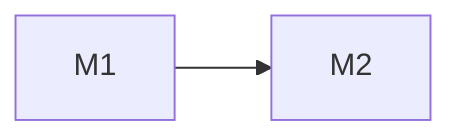

# Architecture: <project>

Status: proposed · Last updated: <yyyy-mm-dd>

Tracker: [project.md](project.md)

Based on: requirements.md @ <12-char hash> · stack.md @ <12-char hash>

IDs are permanent. A removed item keeps its line, marked `dropped`. `State`
is `proposed`, `changed by user`, or `settled`; only the grill settles.
Prefixes: `M` module, `E` entity, `F` flow, `K` concern, `B` abuse case,
`AQ` open question, `AA` accepted unknown.

## Shape

<The architecture in one paragraph, from the user's side first.>

- Choice: <for example one deployable unit with modules inside, or two>
- State: proposed
- Because: <R3, N1, C2: what in them forces this>
- Alternative shape: <a structurally different one>: <why it loses, and what would force it>
- Deployment units: <what ships separately, and where each runs, from stack.md>

## Diagram

## Modules

### M1 <Name>

- Responsibility: <one sentence>
- Interface: <everything a caller must know: operations, inputs and outputs, invariants, ordering, error modes>
- Depends on: <M2, an external service>
- Owns: <E1, E2: data only this module writes>
- Serves: <R1, R3, N2>
- Seam: <where tests cross; adapters at it. One adapter is hypothetical, two is real>
- State: proposed
- Assumes: <what it rests on that only the user knows> (AQ1)
- Deletion test: <what reappears across callers if it is deleted. Added by the grill>
- Fixed by: <C2, only when the requirements fix it>
- Was: <previous content, only after the user changed it>
- ADR: <docs/adr/NNNN-slug.md, only if the grill wrote one>

## Data model

### E1 <Glossary term>

- Meaning: <one sentence, the glossary's sense>
- Fields that matter: <the ones the requirements depend on>
- Relations: <to other entities, and what happens to this one when they go>
- Lifecycle: <states, transitions, who may make each>
- Invariants: <what must always be true>
- Retention and deletion: <how long, how removed, what remains>
- Size: <rows or bytes at the requirements' numbers>
- Owner: <M1>
- Serves: <R1>
- State: proposed

## Flows

### F1 <Name>

- Serves: <R1, N2>
- Trigger: <who or what starts it>
- Steps: <1. M1 does … 2. M2 does …>
- Failure at each step: <what goes wrong, and what happens next>
- Seen by the caller: <errors and messages>
- Consistency: <transaction boundary, retry, duplicates>
- Permissions: <who may, and where it is checked>
- Records: <what is logged or stored>
- At the numbers: <time and load at the requirements' numbers>
- State: proposed

## Cross-cutting concerns

### K1 <Concern>

- Approach: <what the design does>
- Because: <R / N / C IDs>
- Applies to: <M / F IDs>
- State: proposed

## Threats

### B1 <Abuse case>

- Asset: <what is at stake>
- Actor: <who, with what access>
- Trust boundary: <where trust changes>
- Mitigation: <what stops it>
- Verification: <the test or check that shows it holds>
- Serves: <N3>
- State: proposed

## Traceability

| Requirement | Served by |
| --- | --- |
| R1 | F1, M1 |
| N1 | K2, M3 |

## Not needed

- <Thing>: <why the design has none, and the R / N / C it would have served>

## Accepted unknowns

- **AA1** — <something the user chose not to settle yet, and why. Added by the grill>

## Open questions

- **AQ1** — <what only the user can answer, and which item waits on it>
