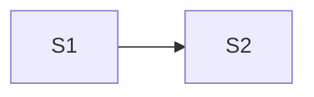

# Design: <project>

Status: proposed · Last updated: <yyyy-mm-dd>

Tracker: [project.md](project.md)

Based on: requirements.md @ <12-char hash> · stack.md @ <12-char hash | none> · architecture.md @ <12-char hash | none>

Paper: <file name> (fileId <id>) · <page name> (pageId <id>), or `not pinned`

IDs are permanent. A removed item keeps its line, marked `dropped`. `State`
is `proposed`, `changed by user`, or `settled`; only the grill settles.
Prefixes: `BR` brief, `U` moment of use, `J` journey, `S` screen, `P` pattern,
`DQ` open question, `DA` accepted unknown.

## Brief

The user's own words, never edited. They outrank the proposals below.

- **BR1** — "<exact words>"

## Idea

<The design in one paragraph, from the person's side first.>

- Idea: <one sentence: what this design is trying to be>
- Promise: <one sentence: what the person gets>
- Feel: <word>: <the rule it means, checkable on a screen>; <word>: <rule>; <word>: <rule>
- Refuses: <what this is not, so nobody drifts into it>
- Reference: <named product used as the base, or "assumed: <product>">
- Changes: <how it departs from the base, each as a rule>
- Platform: <desktop 1440×900 · phone 390×844 · both>
- State: proposed
- Because: <BR1, R3, N2: what in them points here>
- Alternative idea: <a structurally different way to organise it>: <why it loses, and what would force it>

## Moments of use

### U1 <Kind of user>

- Who: <in the requirements' words>
- Device and place: <what, where>
- Hurry and frequency: <how rushed, how often>
- Just before: <what they were doing when they opened it>
- Knows: <what they can be expected to know>
- Serves: <R1>
- State: proposed
- Assumes: <what only the user knows> (DQ1)

## Journeys

### J1 <What the person is trying to do>

- Serves: <R1, F2>
- Who: <U1>
- Starts at: <S1>
- Steps: <1. S1: … 2. S2: … 3. done>
- Length: <screens, and the number of decisions the person makes>
- When it fails: <at step 2 the architecture says …; the person sees …, and can …>
- State: proposed
- Was: <previous content, only after the user changed it>

## Screens

### S1 <Name>

- Purpose: <one task, one sentence>
- Primary action: <the one thing this screen wants done>
- Seen first: <what the eye lands on>
- Reached from: <S2, J1, the start>
- Goes to: <S3, S4>
- Serves: <R1, J1>
- Shows: <entities and fields, in glossary terms, with sample data. Samples from the user are exact; others are marked (sample)>
- Controls: <what can be done here, primary first>
- States:
  - Default: <…>
  - Empty: <what is shown, the words, the way forward>
  - Loading: <…>
  - Error: <from the architecture's "Seen by the caller", the words, what the person can do>
  - Denied: <who sees this and what they see instead. Omit if everyone sees the same>
- Draw: <states that get their own board, for example empty, error>
- Paper: not built
- State: proposed
- Assumes: <…> (DQ2)
- Fixed by: <C2, only when the requirements fix it>
- Was: <previous content, only after the user changed it>

## Patterns

### P1 <Name>

- Rule: <what it always does>
- Applies to: <S1, S3>
- State: proposed

## Visual direction

Reviewed in Paper, not grilled. The grill asks about the idea, not colour.

- Base and changes: <from Idea>
- Colour attitude: <neutral ground, one accent, and so on, in words>
- Type: <a short scale, two weights, the family attitude>
- Spacing step: <4 or 8>
- Radius and depth: <…>
- Density: <…>
- Tokens: <names Paper will create, for example --ground, --ink, --accent, --space-2>
- State: proposed (reviewed in Paper, not grilled)

## Diagram

## Traceability

| Requirement or flow | Served by |
| --- | --- |
| R1 | J1, S1 |
| N1 | P2 |
| F3 | J2 |
| R5 | no UI: <reason> |

## Not designed

- <Thing>: <why it has no screen, and the R / N / C it would have served>

## Accepted unknowns

- **DA1** — <something the user chose not to settle yet, and why. Added by the grill>

## Open questions

- **DQ1** — <what only the user can answer, and which item waits on it>
