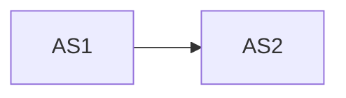
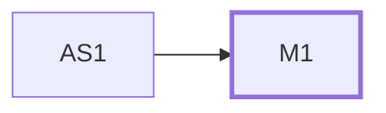

# Architecture: #<n> <title>

Status: proposed · Key: <n>-<slug> · Last updated: <yyyy-mm-dd>

Tracker: [tracker.md](tracker.md)

Based on: requirements.md @ <12-char hash> · Code read at: <short sha> on <default branch>

IDs are permanent. A removed item keeps its line, marked `dropped`. `State`
is `proposed`, `changed by user`, or `settled`; only the grill settles.
Prefixes: `AS` as is, `M` module, `E` entity, `F` flow, `K` concern, `B` abuse
case, `RK` risk to what exists, `AQ` open question, `AA` accepted unknown.
`Change` is `new`, `extends AS<n>` or `unchanged, used`.

## As is

The architecture the feature lands in, read from the code at the commit
above. Facts only, each with its source. The feature is designed around these;
it does not redesign them.

### AS1 <Name the code uses>

- Kind: <module · entity · flow · concern · convention · decision>
- What it is: <responsibility, or meaning, in one sentence>
- Interface: <what callers use today: operations, inputs, outputs, errors, invariants>
- Owns or depends on: <data it writes; what it calls>
- Source: `<path:line>`, <doc or ADR, if any>

### Stack and commands

- <Language, framework and library versions the feature uses, from the
  manifest or lockfile> (`path`)
- Test: `<command>` · Lint: `<command>` · Type check: `<command>` · Build:
  `<command>` (`<where each was found>`). A command the repository does not
  have is written `none`.

### As-is diagram

## Shape

<How the feature fits, in one paragraph, from the user's side first: what it
extends, what is new, where its data lives, and why that is the least new
architecture that serves every requirement.>

- Choice: <for example: extends AS2's module with one new operation and one
  table it owns>
- State: proposed
- Because: <R3, N1, C2, AS4: what in them forces this>
- Alternative shape: <a structurally different fit: a new module instead of
  extending one, another owner for the data, background instead of in the
  request>: <why it loses, and what would force it>

## Diagram

The to-be graph; new modules and changed edges marked.

## Modules

### M1 <Name>

- Change: <new: why no AS module can own this | extends AS2: what is added>
- Responsibility: <one sentence>
- Interface: <for a new module, everything a caller must know; for an
  extended one, the operations added or changed, and whether existing callers
  see any difference>
- Depends on: <AS3, M2, an external service>
- Owns: <E1: data only this module writes>
- Serves: <R1, N2>
- Seam: <where tests cross; the existing test seam it uses, if any>
- State: proposed
- Assumes: <what it rests on that only the user knows> (AQ1)
- Deletion test: <what reappears across callers if it is deleted. Added by the grill>
- Was: <previous content, only after the user changed it>

## Data model

### E1 <Glossary term>

- Change: <new | extends AS4: fields added or changed>
- Meaning: <one sentence>
- Fields that matter: <the ones the requirements depend on>
- Existing rows: <default, backfill or migration for data written before
  this ships; whether it can be run twice; how it is undone. `none` for a new
  entity>
- Relations: <to other entities, and what happens to this one when they go>
- Lifecycle: <states, transitions, who may make each>
- Invariants: <what must always be true>
- Retention and deletion: <how long, how removed>
- Size: <rows or bytes at the requirements' numbers, and today's volume from AS4>
- Owner: <M1, or the AS module that already writes it; one writer>
- Serves: <R1>
- State: proposed

## Flows

### F1 <Name>

- Change: <new | extends AS5: the steps added>
- Serves: <R1, N2>
- Trigger: <who or what starts it>
- Steps: <1. AS2 does … 2. M1 does …>
- Failure at each step: <what goes wrong, and what happens next>
- Seen by the caller: <errors and messages>
- Consistency: <transaction boundary, retry, duplicates>
- Permissions: <who may, and the existing check that enforces it (AS6)>
- Records: <what is logged or stored, through the existing mechanism>
- At the numbers: <time and load at the requirements' numbers>
- State: proposed

## Cross-cutting concerns

### K1 <Concern>

- Approach: <the existing mechanism used (AS7), or what is added and why none exists>
- Because: <R / N / C IDs>
- Applies to: <M / F IDs>
- State: proposed

## Threats

### B1 <Abuse case>

- Asset: <what is at stake>
- Actor: <who, with what access>
- Trust boundary: <where trust changes>
- Mitigation: <what stops it>
- Verification: <the test or check that shows it holds>
- Serves: <N3>
- State: proposed

## Risks to what exists

### RK1 <Existing behaviour>

- What could change: <the existing caller, screen, job, client or data that
  sees something different, from AS items>
- Guarded by: <the existing test that catches it (`path`), or the new one to write>
- State: proposed

## Traceability

| Requirement | Served by |
| --- | --- |
| R1 | F1, M1 |
| N1 | K1 |
| C2 | respected: AS3 unchanged |

## Fit

- New deployable, service, datastore or runtime: <none | which, and the item>
- Module boundary changed: <none | which, and every caller affected>
- New dependency: <none | which, with the simpler option, and its AQ>
- Size: one pull request, about <n> commits (<the order>)

## Not needed

- <Thing>: <why the feature needs none, and the R / N / C it would have served>

## Accepted unknowns

- **AA1** — <something the user chose not to settle yet, and why. Added by the grill>

## Open questions

- **AQ1** — <what only the user can answer, and which item waits on it>

## Log

- <yyyy-mm-dd>: Proposed from requirements.md @ <hash>, code at <short sha>.
