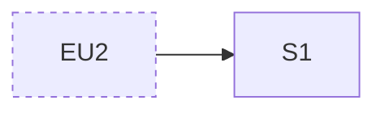

# Design: #<n> <title>

Status: proposed · Key: <n>-<slug> · Last updated: <yyyy-mm-dd>

Tracker: [tracker.md](tracker.md)

Based on: requirements.md @ <12-char hash> · architecture.md @ <12-char hash | none> · Code read at: <short sha>

Paper: <file name> (fileId <id>) · <page name> (pageId <id>), or `not pinned`

IDs are permanent. A removed item keeps its line, marked `dropped`. `State`
is `proposed`, `changed by user`, or `settled`; only the grill settles.
Prefixes: `BR` brief, `EU` existing UI, `U` moment of use, `J` journey, `S`
screen, `P` pattern, `DQ` open question, `DA` accepted unknown. `Change` is
`new`, `changes EU<n>`, or `unchanged, passed through`.

## Brief

The user's own words, never edited. They outrank the proposals below.

- **BR1** — "<exact words>"

## Existing UI

The app as a person sees it today where the feature lands, read from the
code (and from Paper when the app is drawn there). The feature is designed
inside it; it does not restyle it.

### EU1 <Name the app uses>

- Kind: <screen · navigation · component · token · pattern · copy style>
- What it is: <what the person sees and does there, or what the component
  draws, or the token's value>
- Used by: <screens or places>
- Source: `<path:line>`, <Paper board, if any>

## Idea

<Where the feature lives for the person, in one paragraph.>

- Idea: <one sentence: what this feature is to the person>
- The one thing: <the single action it exists for, and where it starts>
- Placement: <the existing screen, menu or flow it hangs on (EU3), and why there>
- Follows: <the existing conventions it keeps, each as a rule with its EU:
  "primary action bottom right, as EU5", "tables as EU7">
- Refuses: <what it must not do to the app around it>
- Platform: <as the app: desktop 1440×900 · phone 390×844 · both>
- State: proposed
- Because: <BR1, R3, N2: what in them points here>
- Alternative idea: <a structurally different placement: another entry
  point, a new screen instead of a change to EU2, inline instead of a dialog>:
  <why it loses, and what would force it>

## Moments of use

### U1 <Kind of user>

- Who: <in the requirements' words>
- Device and place: <what, where>
- Hurry and frequency: <how rushed, how often>
- Just before: <what they were doing in the app when they reach this>
- Knows: <what they can be expected to know>
- Serves: <R1>
- State: proposed
- Assumes: <what only the user knows> (DQ1)

## Journeys

### J1 <What the person is trying to do>

- Serves: <R1, F2>
- Who: <U1>
- Starts at: <EU2 (existing) or S1>
- Steps: <1. EU2: … 2. S1: … 3. done, back on EU2>
- Length: <screens, and the number of decisions the person makes>
- When it fails: <at step 2 the architecture's F2 says …; the person sees …, and can …>
- State: proposed
- Was: <previous content, only after the user changed it>

## Screens

### S1 <Name>

- Change: <new | changes EU2: what is added or moved, and what stays as it is>
- Purpose: <one task, one sentence>
- Primary action: <the one thing this screen wants done>
- Seen first: <what the eye lands on>
- Reached from: <EU2, S2>
- Goes to: <S3, EU2>
- Serves: <R1, J1>
- Shows: <entities and fields, in glossary terms, with sample data. Samples from the user are exact; others are marked (sample)>
- Controls: <what can be done here, primary first>
- Built from: <the existing components and patterns it uses (EU4, EU7)>
- States:
  - Default: <…>
  - Empty: <what is shown, the words, the way forward>
  - Loading: <…>
  - Error: <from the architecture's "Seen by the caller", in the app's existing error style, the words, what the person can do>
  - Denied: <who sees this and what they see instead. Omit if everyone sees the same>
- Draw: <states that get their own board, for example empty, error>
- Paper: not built
- State: proposed
- Assumes: <…> (DQ2)
- Was: <previous content, only after the user changed it>

## Patterns

Only a pattern this feature introduces and two or more of its screens share.
Existing patterns are `EU` items and are reused, not redefined.

### P1 <Name>

- Rule: <what it always does>
- Applies to: <S1, S3>
- Why not an existing one: <the EU pattern that does not fit, and why>
- State: proposed

## Visual

The app's existing look, reused. Reviewed in Paper, not grilled.

- Tokens: <the existing tokens the screens use, by the names the code uses (EU8)>
- Components: <the existing components the screens are built from>
- New: <a token or component the feature needs that the app lacks, each with
  why and a DQ; normally none>
- State: proposed (reviewed in Paper, not grilled)

## Diagram

## Traceability

| Requirement or flow | Served by |
| --- | --- |
| R1 | J1, S1 |
| F2 | J1 (failure at step 2) |
| R5 | no UI: <reason> |

## Not designed

- <Thing>: <why it has no screen, and the R / N / C it would have served>

## Accepted unknowns

- **DA1** — <something the user chose not to settle yet, and why. Added by the grill>

## Open questions

- **DQ1** — <what only the user can answer, and which item waits on it>

## Log

- <yyyy-mm-dd>: Proposed from requirements.md @ <hash> and architecture.md @ <hash>.
